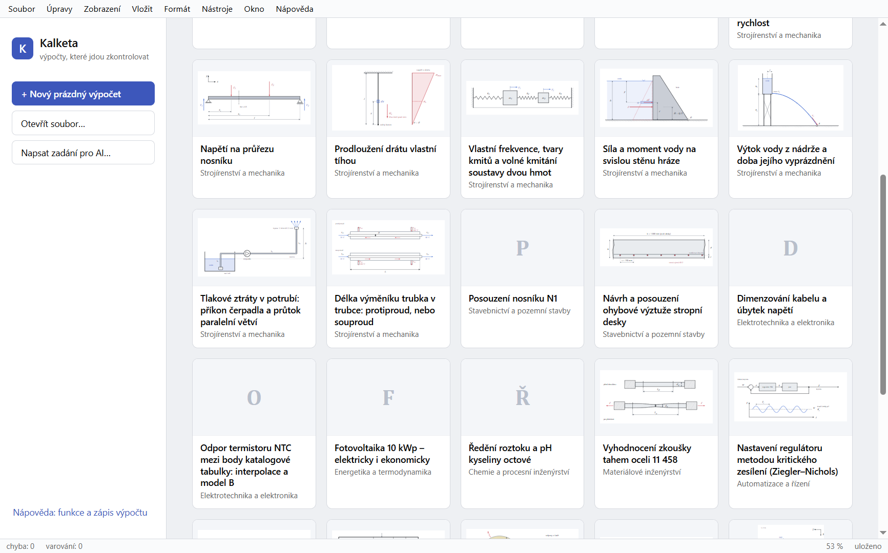

# Kalketa

[](https://github.com/janvanik123456789-del/kalketa/actions/workflows/tests.yml)

**Technické výpočty, které jdou zkontrolovat.** Obecný technický výpočtář jako Mathcad, který umí dobře pracovat s daty. Výpočet se píše jako text s jednotkami a tiskne se jako klasický technický výpočet: vzorec, dosazení, výsledek, posudek. Tabulky, obrázky, zdroje a teorie jsou součástí výpočtu (listu), ne programu.

[English](README.md) · [Stažení](https://github.com/janvanik123456789-del/kalketa/releases) · [Wiki](https://github.com/janvanik123456789-del/kalketa/wiki) · licence MIT



## Stažení a instalace

Sestavení pro Windows (instalátor nebo přenosný `.exe`) a Linux (`.AppImage`, který běží bez instalace, nebo `.deb`) jsou na stránce [Releases](https://github.com/janvanik123456789-del/kalketa/releases). Program mluví česky a anglicky. Instalace, první výpočet a přehled jazyka jsou ve [wiki](https://github.com/janvanik123456789-del/kalketa/wiki).

## Co umí

- **Jednotky všude**, rozměrová kontrola, °C a K odlišené, měny jako jednotky, jednotky starých učebnic (`kp`, `at`, `psi`, `Btu`) s přesnou hodnotou.
- **Tisk jako ruční výpočet:** vzorec, dosazení, výsledek; posudky s využitím a souhrnem na první straně; ověřované kroky odvození.
- **Data ve výpočtu:** tabulky v listu i z CSV a Excelu, `pick`, `find_min`, interpolace, počítané sloupce a součty, tabulky po řádcích, kde řádek čte ten nad sebou (`prev`).
- **Řešič a analýza:** `solve` pro rovnice i soustavy, také jako hodnota uvnitř vzorce; kořeny jako na papíře; soustavy diferenciálních rovnic a okrajové úlohy; integrály do nekonečna, derivace až do 10. řádu, proložení naměřených bodů.
- **Konstrukce:** `beam` pro spojité nosníky s vetknutím, klouby, osamělými silami a momenty, přesně deformační metodou; `frame` pro rovinné rámy a příhradoviny; `i_section` pro charakteristiky válcovaných průřezů.
- **Matice, komplexní čísla, statistika:** komplexní matice v `lsolve`, `rank`, `cond`, `nullspace` a `whole` (koeficienty chemické rovnice); rozdělení, speciální funkce, opakovatelná náhodná čísla pro Monte Carlo, histogramy, krabicové grafy a chybové úsečky.
- **Kresby svázané s výpočtem:** kóta kresby může sledovat jméno z listu, takže schéma nosníku nebo průřez se při změně `L` překreslí v měřítku.
- **Varianty výpočtu** v jednom listu a jejich porovnání `compare`.
- **Přesné výsledky** na vyžádání: `{exact}` ukáže zlomek nebo odmocninu (49/9 ≐ 5,444).
- **Podklady s teorií** ověřovanou jádrem a **Kontrola v Pythonu**, která list přepočítá nezávisle a porovná hodnotu po hodnotě. Dvě stránky vedle sebe ukážou výpočet a jeho teorii zároveň.
- **Import ze SMath Studia:** list se převede na list Kalkety a výsledky uložené v souboru se porovnají s výsledky Kalkety. Co převést nejde, zůstane vidět jako text s důvodem.
- **Knihovna vzorců:** Vložit → Vzorec z knihovny: 100 vzorců ze vzorových výpočtů, přeskládaných na veličinu, na kterou kliknete, s příkladnými hodnotami a zdrojem.
- **AI volitelně:** vysvětlí, zkontroluje a navrhne změny, které člověk přijme nebo odmítne, a ověří výsledky v Pythonu jinou cestou. Sama výpočet nemění. Claude nebo lokální model, nebo vůbec.
- **AI zvenku (MCP):** vaše vlastní AI aplikace (Claude Code, Claude Desktop, aplikace místního modelu) se připojí ke Kalketě, čte otevřený list a navrhuje změny, na vaše předplatné, bez API klíče. Vypnuté, dokud ho nezapnete, jen na tomto počítači a s tokenem.
- **AI z obyčejného chatu:** do ChatGPT, Claude.ai nebo Gemini přiložte [`llms.txt`](https://raw.githubusercontent.com/janvanik123456789-del/kalketa/main/llms.txt) (návod jazyka Kalkety pro AI) a napište, co chcete spočítat. Výpočet z odpovědi vložte do Kalkety přes Ctrl+V, tabulku do datové vrstvy, skript do Ověření v Pythonu.
- **54 vzorových výpočtů** ve všech oborech, každý česky i anglicky; 32 z nich jsou řešené příklady z veřejných zdrojů (skripta, sbírky, články), s odkazem na zdroj a nezávisle ověřené.

## Dokumentace

- [Wiki](https://github.com/janvanik123456789-del/kalketa/wiki): instalace, první výpočet, jazyk, tabulky, vrstvy, import, vzory
- [Filozofie](docs/01-filozofie.md)
- [Architektura a plán realizace](docs/02-architektura.md)
- [Jazyk výpočtu](docs/03-jazyk.md)

## Vývoj

```bash
npm install
npm test          # všechny testy (jednotkové, architektura, referenční výpočty)
npm run typecheck # kontrola typů
npm run desktop   # sestaví a spustí program
npm run smoke     # program ovládaný skutečnou myší a klávesnicí
npm run llms      # znovu vytvoří llms.txt z návodu programu (test hlídá, že odpovídá)
npm run smoke:linux  # totéž v Linuxu (WSL)
```

Stav projektu určují testy, ne ručně psané zprávy.

## Editor v prohlížeči

```bash
npm run editor      # spustí editor na http://localhost:5173
npm run build:editor
```

## Příkazová řádka

```bash
npm run build
node packages/cli/dist/main.js run reference/04_Stavebnictvi_a_pozemni_stavby/R1-nosnik/nosnik.cc --lang cs
node packages/cli/dist/main.js trace reference/04_Stavebnictvi_a_pozemni_stavby/R1-nosnik/nosnik.cc σ --lang cs
node packages/cli/dist/main.js print reference/04_Stavebnictvi_a_pozemni_stavby/R1-nosnik/nosnik.cc --lang cs --out nosnik.html --pdf nosnik.pdf
node packages/cli/dist/main.js import list.sm --out list.kalk
node packages/cli/dist/main.js pack reference/04_Stavebnictvi_a_pozemni_stavby/R1-nosnik/nosnik.cc --out nosnik.kalk
node packages/cli/dist/main.js unpack nosnik.kalk --into nosnik
node packages/cli/dist/main.js import-table katalog.xlsx --name Profily --into nosnik
```

## Struktura

```text
packages/core/          výpočetní jádro (bez UI, souborů a znalosti oboru)
packages/i18n/          překlady hlášení a popisků, formát čísel
packages/sheet/         tabulky (CSV, Excel), soubor listu .kalk, vrstvy
packages/render/        tisková vrstva: klasický technický výpočet (HTML + MathML)
packages/chart/         grafy
packages/chart-editor/  úpravy grafů myší
packages/canvas/        kreslicí plátno, kóty svázané s výpočtem
packages/import/        import výpočtů jiných programů (SMath Studio)
packages/ai/            volitelný pomocník AI
packages/editor/        editor (React): list s živým přepočtem, tabulky, původ hodnot, tisk
packages/desktop/       program pro počítač (Electron)
packages/cli/           příkazová řádka
reference/              vzorové výpočty s ověřenými výsledky, tříděné podle oboru
tests/                  testy celého repozitáře (pravidla architektury)
docs/                   filozofie, architektura, jazyk
```

## Licence

[MIT](LICENSE). Balíčky třetích stran, které program obsahuje, mají své licence; jejich seznam je v Nápověda → O programu.
