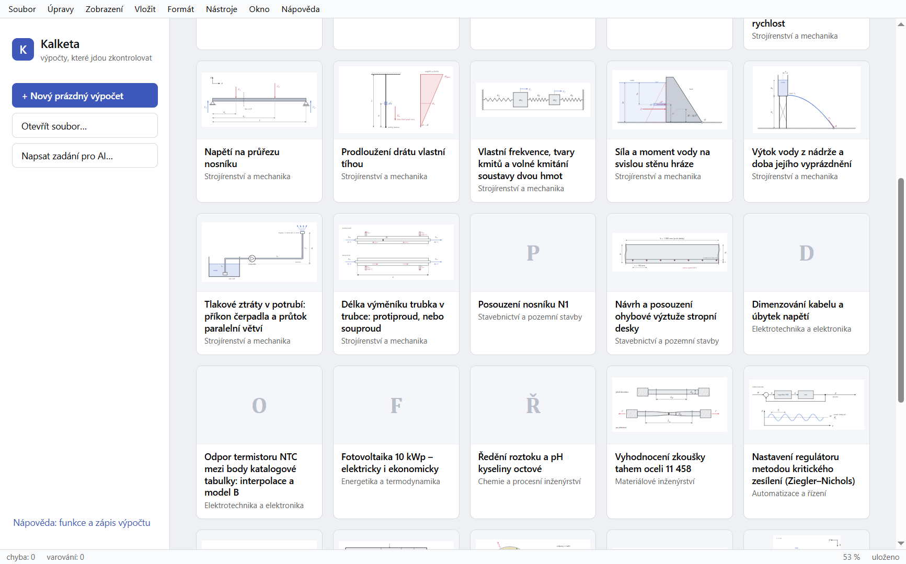
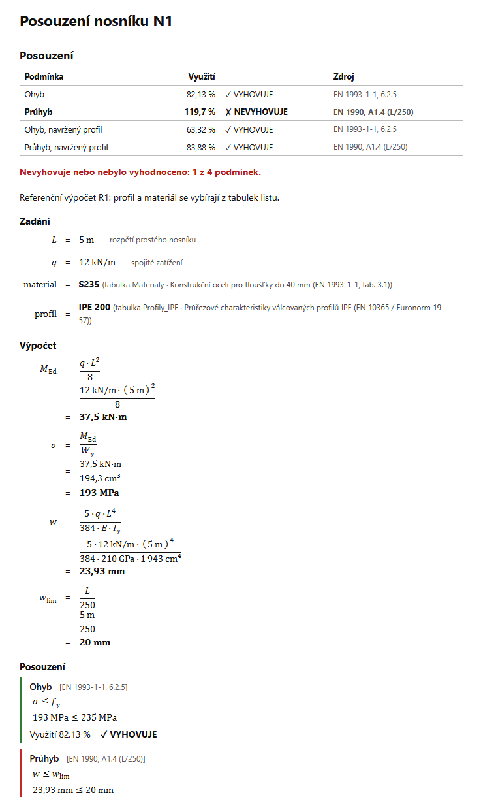
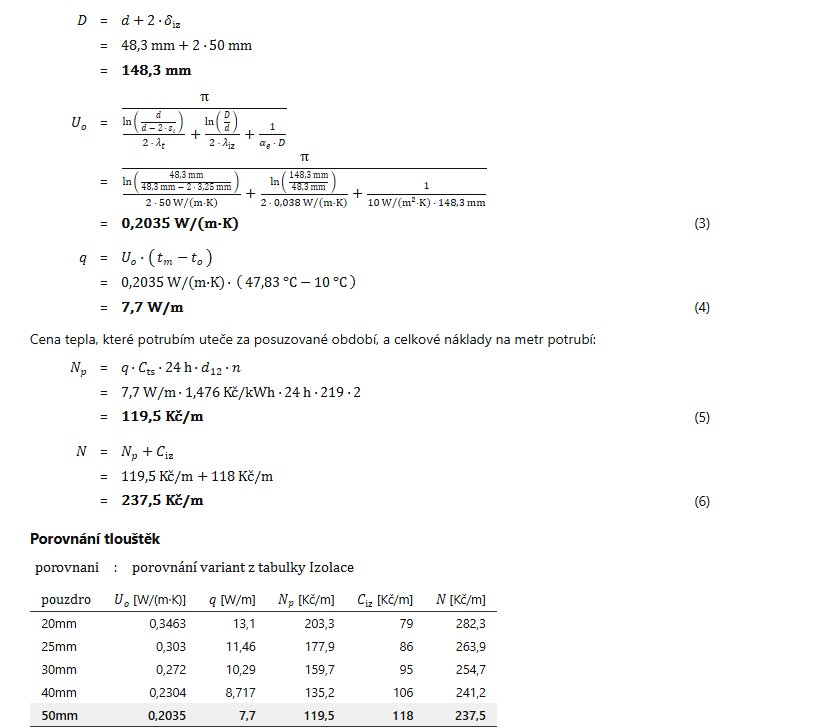

# Kalketa

[](https://github.com/janvanik123456789-del/kalketa/actions/workflows/tests.yml)

**Engineering calculations that can be checked.** Kalketa is a desktop calculator for engineers in the spirit of Mathcad: you write the calculation as text, with units, and it prints as a classic technical report: formula, numbers put in, result, check. Tables, pictures, sources and theory belong to the calculation file, not to the program.

[Česky](README.cs.md) · [Download](https://github.com/janvanik123456789-del/kalketa/releases) · [Wiki](https://github.com/janvanik123456789-del/kalketa/wiki) · MIT licence



## What it does

- **Units everywhere.** `q := 12 kN/m`, `M := q·L^2/8 | kN·m`. Wrong dimensions are an error, °C and K are told apart, currencies are units too, and the units of old textbooks (`kp`, `at`, `psi`, `Btu`) are known with their exact values.
- **Prints like a hand calculation.** Each line shows its formula, the values put in and the result; checks (`check σ ≤ f_y`) end with their utilization and a summary on the first page. Steps of a derivation are checked, not just printed.
- **Data inside the calculation.** Tables written in the sheet or imported from CSV and Excel, `pick` and `find_min` over them (the lightest section that passes), interpolation, calculated columns and totals, tables built row by row where each row reads the one above (`prev`).
- **Solver and calculus.** `solve` for equations and systems, also as a value inside a formula; roots of polynomials as on paper; systems of differential equations and boundary value problems; integrals to infinity, derivatives of any order up to 10, fitting of measured points.
- **Structures.** `beam` for continuous beams with fixed ends, hinges, point loads and moments, exact by the stiffness method; `frame` for plane frames and trusses; `i_section` for the properties of rolled sections.
- **Matrices, complex numbers, statistics.** Complex matrices in `lsolve`, `rank`, `cond`, `nullspace` and `whole` (the coefficients of a chemical equation); distributions, special functions, repeatable random numbers for Monte Carlo, histograms, box plots and error bars.
- **Drawings tied to the calculation.** A dimension of a drawing can follow a name of the sheet, so a beam scheme or a section is redrawn in scale when `L` changes.
- **Variants.** One sheet, several variants of the inputs (`table Variants: {variants=B}`); `compare(Variants, M, σ)` calculates the sheet for each and puts them side by side.
- **Exact results on request.** `{exact}` shows 49/9 s⁻² ≐ 5.444 s⁻² where the calculation stays a fraction or a root.
- **Theory beside the calculation.** A notes layer holds the theory with formulas the core verifies, and another one an independent check of the whole sheet in Python (built-in, sandboxed), compared value by value. Two pages side by side show the calculation and its theory together.
- **Import from SMath Studio.** A worksheet becomes a Kalketa sheet, and the results stored in the file are compared with Kalketa's. What cannot be converted stays as visible text with its reason.
- **Formula library.** Insert → Formula from the library: 100 formulas from the samples, rearranged for the quantity you click, inserted with example values and their source.
- **AI optional.** An assistant can explain, review and propose changes, which you accept or reject line by line, and check results in Python another way. It never changes the calculation by itself. Works with Claude or a local model, or not at all.
- **AI from outside (MCP).** Your own AI application (Claude Code, Claude Desktop, a local model's app) can connect to Kalketa, read the open sheet and propose changes, on your own subscription, with no API key. Off until you switch it on, local only, with a token.
- **54 sample calculations** in all fields from structural design to pharmacokinetics, each in Czech and in English; 32 of them are worked examples from published sources (textbooks, university exercises, journals), linked to their source and verified independently.





## Download

Windows (installer or portable `.exe`) and Linux (`.AppImage`, which runs without installing, or `.deb`) builds are on the [Releases](https://github.com/janvanik123456789-del/kalketa/releases) page. The program speaks Czech and English. How to install, a first calculation and an overview of the language are in the [wiki](https://github.com/janvanik123456789-del/kalketa/wiki).

## Build from source

Node.js 24 or newer.

```bash
npm install
npm test             # all tests: unit, architecture rules, reference calculations
npm run desktop      # build and start the desktop program
npm run smoke        # the desktop program driven by real mouse and keyboard input
```

The packaged builds: `npm run dist --workspace @kalketa/desktop` (Windows), `npm run dist:linux --workspace @kalketa/desktop` (Linux).

The command line runs, traces, prints and imports calculations:

```bash
npm run build
node packages/cli/dist/main.js run reference/04_Stavebnictvi_a_pozemni_stavby/R1-nosnik/nosnik.cc
node packages/cli/dist/main.js print reference/04_Stavebnictvi_a_pozemni_stavby/R1-nosnik/nosnik.cc --out beam.html --pdf beam.pdf
node packages/cli/dist/main.js import worksheet.sm --out worksheet.kalk
```

## How it is built

```text
packages/core/          calculation core: language, units, evaluator, solver (no UI, no files)
packages/i18n/          messages and labels in Czech and English, number formats
packages/sheet/         tables (CSV, Excel), the .kalk file, layers
packages/render/        the print: HTML and MathML, charts in SVG
packages/chart/         charts
packages/chart-editor/  editing charts with the mouse
packages/canvas/        the drawing canvas, dimensions tied to the calculation
packages/import/        import of calculations of other programs (SMath Studio)
packages/ai/            the optional AI assistant
packages/editor/        the editor (React)
packages/desktop/       the desktop program (Electron)
packages/cli/           command line: run, trace, print, import, pack
reference/              the sample calculations with their verified results
```

The design documents are in Czech: [philosophy](docs/01-filozofie.md), [architecture](docs/02-architektura.md), [the calculation language](docs/03-jazyk.md).

## Licence

[MIT](LICENSE). The third-party packages the program contains keep their own licences, listed in Help → About.
