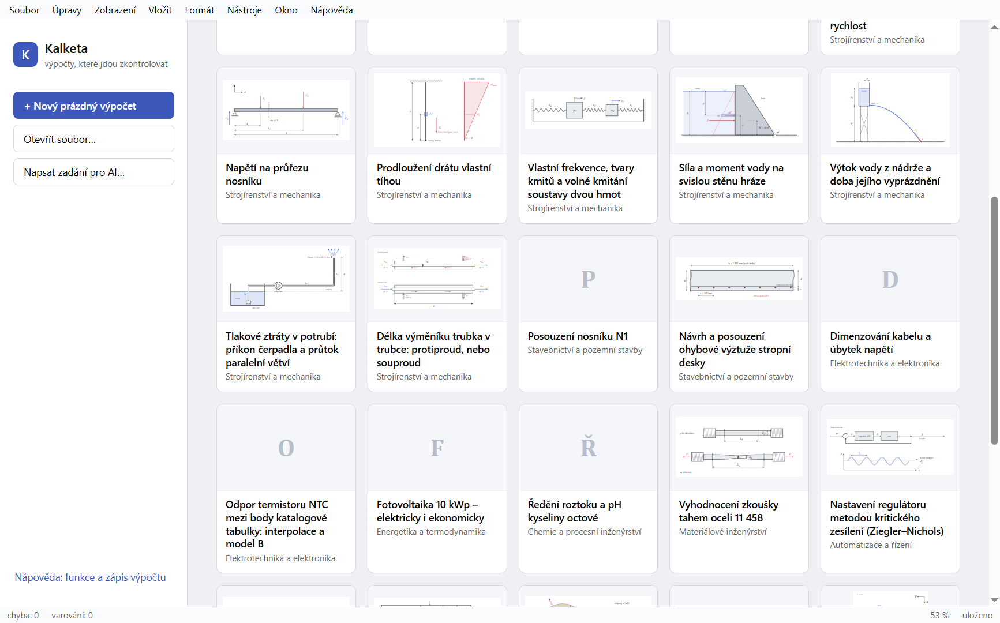
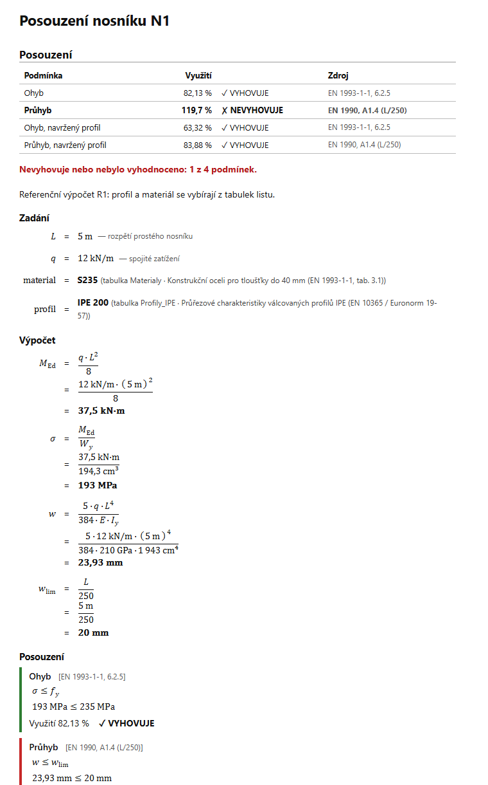
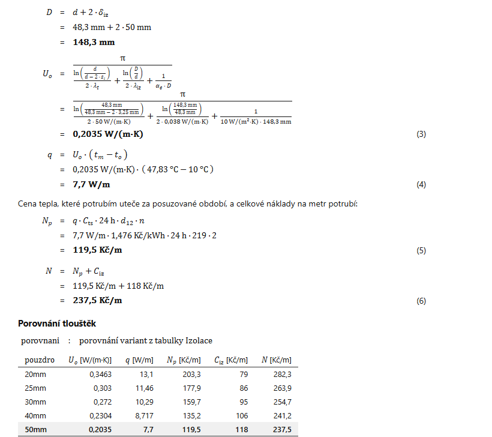

# Kalketa

[](https://github.com/janvanik123456789-del/kalketa/actions/workflows/tests.yml)

**Engineering calculations that can be checked.** Kalketa is a desktop calculator for engineers in the spirit of Mathcad: you write the calculation as text, with units, and it prints as a classic technical report: formula, numbers put in, result, check. Tables, pictures, sources and theory belong to the calculation file, not to the program.

[Česky](README.cs.md) · [Download](https://github.com/janvanik123456789-del/kalketa/releases) · MIT licence



## What it does

- **Units everywhere.** `q := 12 kN/m`, `M := q·L^2/8 | kN·m`. Wrong dimensions are an error, °C and K are told apart, currencies are units too.
- **Prints like a hand calculation.** Each line shows its formula, the values put in and the result; checks (`check σ ≤ f_y`) end with their utilization and a summary on the first page. Steps of a derivation are checked, not just printed.
- **Data inside the calculation.** Tables written in the sheet or imported from CSV and Excel, `pick` and `find_min` over them (the lightest section that passes), interpolation, calculated columns and totals.
- **Solver and calculus.** `solve` for equations and systems, roots of polynomials as on paper, differential equations with boundary conditions, integrals, derivatives, fitting of measured points, charts and 3D surfaces.
- **Variants.** One sheet, several variants of the inputs (`table Variants: {variants=B}`); `compare(Variants, M, σ)` calculates the sheet for each and puts them side by side.
- **Exact results on request.** `{exact}` shows 49/9 s⁻² ≐ 5.444 s⁻² where the calculation stays a fraction or a root.
- **Theory beside the calculation.** A notes layer holds the theory with formulas the core verifies, and another one an independent check of the whole sheet in Python (built-in, sandboxed), compared value by value.
- **AI optional.** An assistant can explain, review and propose changes, which you accept or reject line by line. It never changes the calculation by itself. Works with Claude or a local model, or not at all.
- **34 sample calculations** in all fields from structural design to pharmacokinetics; 23 of them are worked examples from published sources (textbooks, university exercises, journals), linked to their source and verified independently.





## Download

Windows (installer or portable `.exe`) and Linux (`.AppImage`, which runs without installing, or `.deb`) builds are on the [Releases](https://github.com/janvanik123456789-del/kalketa/releases) page. The program speaks Czech and English.

## Build from source

Node.js 24 or newer.

```bash
npm install
npm test             # all tests: unit, architecture rules, reference calculations
npm run desktop      # build and start the desktop program
npm run smoke        # the desktop program driven by real mouse and keyboard input
```

The packaged builds: `npm run dist --workspace @kalketa/desktop` (Windows), `npm run dist:linux --workspace @kalketa/desktop` (Linux).

## How it is built

```text
packages/core/     calculation core: language, units, evaluator, solver (no UI, no files)
packages/i18n/     messages and labels in Czech and English, number formats
packages/sheet/    tables (CSV, Excel), the .kalk file, layers
packages/render/   the print: HTML and MathML, charts in SVG
packages/chart/    charts
packages/canvas/   the drawing canvas
packages/ai/       the optional AI assistant
packages/editor/   the editor (React)
packages/desktop/  the desktop program (Electron)
packages/cli/      command line: run, trace, print, pack
reference/         the sample calculations with their verified results
```

The design documents are in Czech: [philosophy](docs/01-filozofie.md), [architecture](docs/02-architektura.md), [the calculation language](docs/03-jazyk.md).

## Licence

[MIT](LICENSE). The third-party packages the program contains keep their own licences, listed in Help → About.
