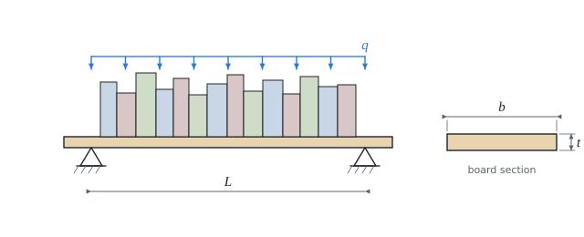

# The board as a simply supported beam

The theory of the calculation, in our own words. Kalketa checks the formulas in the frames as derivations: this layer also shows how to write theory into Sources so that the program watches over it.



## Model

The board lies freely on two brackets: its ends can rotate, but not drop. Such a beam is called **simply supported**. The books stand close side by side, so we take them as a **uniform load** q in newtons per metre; the weight of the board belongs to it too.

## Bending moment

Each bracket carries half of the load, q·L/2. The moment at the place x from the left bracket is the moment of the reaction minus the moment of the load to the left of x:

```kalk
relation M == q·L/2·x - q·x^2/2
derive M == q·x·(L - x)/2
```

It is greatest in the middle. Putting in x = L/2 gives the well-known formula:

```kalk
derive q·(L/2)·(L - L/2)/2 == q·L^2/8
```

## Bending stress

Bending compresses the board on one side and stretches it on the other, most of all at the surface. The stress at the surface is the moment divided by the section modulus W, which is the second moment of area I divided by the distance of the surface from the middle, t/2:

```kalk
relation W == I/(t/2)
relation I == b·t^3/12
derive W == b·t^2/6
```

The thickness t is squared in the formula, the width b only linearly: a board on edge is much stronger than one laid flat.

## Deflection

The curvature of the bent board is proportional to the moment, w″ = −M/(E·I). Integrating twice with zero deflection on both brackets gives the deflection curve; Kalketa checks by differentiating that it is right:

```kalk
derive derivative(q·x·(L^3 - 2·L·x^2 + x^3)/(24·E·I), x: x, order: 2) == -q·x·(L - x)/(2·E·I)
```

The deflection is greatest in the middle:

```kalk
derive q·(L/2)·(L^3 - 2·L·(L/2)^2 + (L/2)^3)/(24·E·I) == 5·q·L^4/(384·E·I)
```

The span is to the **fourth** power in the formula: a shelf a quarter longer sags 2.4 times more. That is why with shelves deflection nearly always decides, not strength.

## The factors

- **k_mod = 0.6:** wood under a load lasting for years carries less than in a short test. The value holds for a dry interior (service class 1).
- **γ_M = 1.3:** a reserve for the scatter of the properties of solid timber (knots, grain).
- **1.35:** a reserve on the permanent load (books are left on the shelf).
- **k_def = 0.6:** creep, wood under permanent load keeps on bending slowly; the final deflection is about 1.6 times the initial one.
- **L/300:** the limit of deflection below which the eye cannot see a shelf sag.
