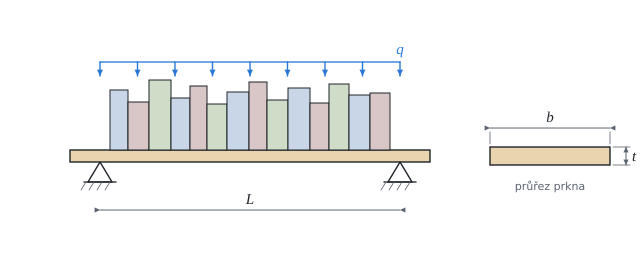

# Prkno jako prostý nosník

Teorie k výpočtu, vlastními slovy. Vzorce v rámečcích Kalketa ověřuje jako odvození: tahle vrstva je zároveň ukázka toho, jak se do Podkladů píše teorie, kterou program hlídá.



## Model

Prkno leží volně na dvou konzolách: konce se mohou pootočit, ale ne propadnout. Takový nosník se jmenuje **prostý**. Knihy stojí hustě vedle sebe, proto je bereme jako **rovnoměrné zatížení** q v newtonech na metr; patří k němu i vlastní tíha prkna.

## Ohybový moment

Každá konzola nese polovinu zatížení, q·L/2. Moment v místě x od levé konzoly je moment reakce minus moment zatížení nalevo od x:

```kalk
relation M == q·L/2·x - q·x^2/2
derive M == q·x·(L - x)/2
```

Největší je uprostřed. Dosazením x = L/2 vyjde známý vzorec:

```kalk
derive q·(L/2)·(L - L/2)/2 == q·L^2/8
```

## Napětí v ohybu

Ohyb prkno na jedné straně stlačuje a na druhé natahuje, nejvíc na povrchu. Napětí na povrchu je moment dělený průřezovým modulem W, a ten je moment setrvačnosti I dělený vzdáleností povrchu od středu, t/2:

```kalk
relation W == I/(t/2)
relation I == b·t^3/12
derive W == b·t^2/6
```

Tloušťka t je ve vzorci na druhou, šířka b jen lineárně: prkno na stojato je mnohem pevnější než naplocho.

## Průhyb

Křivost ohnutého prkna je úměrná momentu, w″ = −M/(E·I). Dvojí integrací s nulovým průhybem na obou konzolách vyjde průhybová čára; že je správná, ověří Kalketa derivací:

```kalk
derive derivative(q·x·(L^3 - 2·L·x^2 + x^3)/(24·E·I), x: x, order: 2) == -q·x·(L - x)/(2·E·I)
```

Uprostřed je průhyb největší:

```kalk
derive q·(L/2)·(L^3 - 2·L·(L/2)^2 + (L/2)^3)/(24·E·I) == 5·q·L^4/(384·E·I)
```

Rozpětí je ve vzorci na **čtvrtou**: o čtvrtinu delší police se prohne 2,4krát víc. Proto u polic skoro vždy rozhoduje průhyb, ne pevnost.

## Součinitele

- **k_mod = 0,6:** dřevo pod zatížením, které trvá roky, unese méně než při krátké zkoušce. Hodnota platí pro suchý interiér (třída provozu 1).
- **γ_M = 1,3:** rezerva na rozptyl vlastností rostlého dřeva (suky, vlákna).
- **1,35:** rezerva na zatížení stálé (knihy se na polici nechávají).
- **k_def = 0,6:** dotvarování, dřevo se pod trvalým zatížením postupně dál prohýbá; konečný průhyb je asi 1,6násobek počátečního.
- **L/300:** mez průhybu, pod kterou prohnutí na polici oko nepozná.

## Ověření v Pythonu

Jiná cesta k průhybu: moment po délce, křivost M/(E·I) a dvojí numerická integrace s nulovým průhybem na konzolách, bez vzorce 5/384. Nejtenčí prkno pak hledá půlením intervalu.

```python
m_k, g, L, b, t = 30.0, 9.81, 0.8, 0.25, 0.018
rho, f_mk, E = 420.0, 24e6, 11e9
k_mod, gamma_M, k_def = 0.6, 1.3, 0.6

q_k = (m_k + rho * b * t) * g
q_d = 1.35 * q_k
M_d = q_d * L**2 / 8
sigma = M_d / (b * t**2 / 6)

def deflection(thickness, n=4000):
    # Curvature −M/(E·I), integrated twice by the trapezoidal rule; then the straight line making w(0) = w(L) = 0.
    I = b * thickness**3 / 12
    dx = L / n
    xs = [i * dx for i in range(n + 1)]
    kappa = [-(q_k * x * (L - x) / 2) / (E * I) for x in xs]
    slope, w = [0.0], [0.0]
    for i in range(n):
        slope.append(slope[-1] + (kappa[i] + kappa[i + 1]) / 2 * dx)
    for i in range(n):
        w.append(w[-1] + (slope[i] + slope[i + 1]) / 2 * dx)
    w = [wi - w[-1] * x / L for wi, x in zip(w, xs)]
    return (1 + k_def) * max(abs(wi) for wi in w)

w_lim = L / 300
low, high = 0.005, 0.05
for _ in range(80):
    mid = (low + high) / 2
    low, high = (mid, high) if deflection(mid) > w_lim else (low, mid)

print("bending", round(sigma / (k_mod * f_mk / gamma_M) * 100, 1), "% of strength; deflection", round(deflection(t) / w_lim * 100, 1), "% of the limit")
result("M_d", M_d, "N·m")
result("σ_m", sigma / 1e6, "MPa")
result("w", deflection(t) * 1000, "mm", rel=1e-5)
result("t_min", high * 1000, "mm", rel=1e-5)
```
