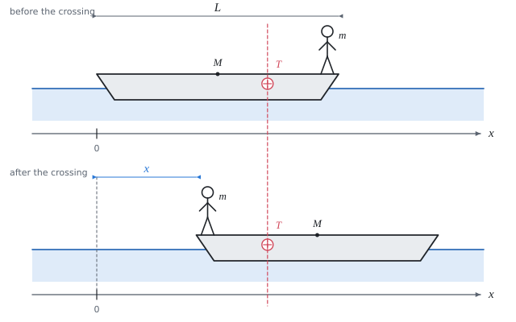

# Centre of mass of a system and internal forces

Theory for the calculation, in our own words. Kalketa verifies the formulas in the frames as derivations.



## Centre of mass of a system of point masses

The position of the centre of mass is the average of the positions weighted by the masses. For two bodies, each replaced by a point at its centre of mass:

```kalk
relation x_T == (m_1·x_1 + m_2·x_2)/(m_1 + m_2)
```

For more bodies, the numerator and the denominator are summed over all of them.

## When the centre of mass does not move

The centre of mass of a system moves as if the whole mass were concentrated in it and the resultant of the **external** forces acted on it. Internal forces (friction of the shoes on the bottom of the boat, the force of the legs, the tension in a rope between two bodies) are paired by the law of action and reaction and their sum is zero; they cannot set the centre of mass in motion.

If the resultant of the external forces is zero and the centre of mass is at rest at the start, it stays at rest. If the bodies shift by Δx₁ and Δx₂, then it must hold that:

```kalk
relation (m_1·x_1 + m_2·x_2)/(m_1 + m_2) == (m_1·(x_1 + Δx_1) + m_2·(x_2 + Δx_2))/(m_1 + m_2)
derive Δx_2 == -m_1·Δx_1/m_2
```

The shifts are opposite and in the inverse ratio of the masses: the heavier body shifts less.

## The boat and the man

Relative to the boat the man shifts by its whole length towards the bow, but relative to the water only by L − x, because the boat meanwhile drives away by x the other way. The condition of the motionless centre of mass:

```kalk
relation m·(x - L) + M·x == 0
derive x == m·L/(M + m)
```

The result does not depend on how fast the man walks or whether he stops on the way: only where he ends up matters. Substituting the given values:

```kalk
m := 70 kg
M := 100 kg
L := 2.5 m
x := m·L/(M + m)
check "The shift of the boat is about 1.03 m": abs(x - 1.0294 m) ≤ 0.0001 m
```

## Assumptions of the calculation

- **The resistance of the water is neglected.** If it were counted, it would be an external force; as long as the boat moves it brakes it and the shift comes out smaller.
- **The tilting of the boat is neglected.** A man at the stern tilts the boat, so the centre of mass shifts vertically too; the effect on the horizontal shift is small.
- The boat and the man are replaced by points at their centres of mass. The man stands at the stern and at the bow right above the end of the boat; in reality he stands a little inside and walks slightly less than L.
