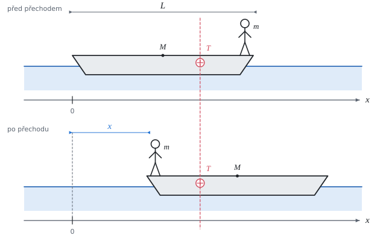

# Těžiště soustavy a vnitřní síly

Teorie k výpočtu, vlastními slovy. Vzorce v rámečcích Kalketa ověřuje jako odvození.



## Těžiště soustavy hmotných bodů

Poloha těžiště je průměr poloh vážený hmotnostmi. Pro dvě tělesa, každé nahrazené bodem v jeho těžišti:

```kalk
relation x_T == (m_1·x_1 + m_2·x_2)/(m_1 + m_2)
```

Pro více těles se v čitateli i ve jmenovateli sčítá přes všechna.

## Kdy se těžiště nepohne

Těžiště soustavy se pohybuje tak, jako by v něm byla soustředěná celá hmotnost a působila na ni výslednice **vnějších** sil. Vnitřní síly (tření bot o dno loďky, síla nohou, napětí v laně mezi dvěma tělesy) se párují podle zákona akce a reakce a jejich součet je nulový; těžiště nemohou rozpohybovat.

Je-li výslednice vnějších sil nulová a těžiště na začátku v klidu, zůstane v klidu. Posunou-li se tělesa o Δx₁ a Δx₂, musí platit:

```kalk
relation (m_1·x_1 + m_2·x_2)/(m_1 + m_2) == (m_1·(x_1 + Δx_1) + m_2·(x_2 + Δx_2))/(m_1 + m_2)
derive Δx_2 == -m_1·Δx_1/m_2
```

Posunutí jsou opačná a v obráceném poměru hmotností: těžší těleso se posune méně.

## Loďka a člověk

Člověk se vůči loďce posune o celou její délku směrem k přídi, vůči vodě ale jen o L − x, protože loďka mezitím odjede o x na druhou stranu. Podmínka nepohyblivého těžiště:

```kalk
relation m·(x - L) + M·x == 0
derive x == m·L/(M + m)
```

Výsledek nezávisí na tom, jak rychle člověk jde ani jestli se cestou zastaví: rozhoduje jen to, kde skončí. Dosazením zadaných hodnot:

```kalk
m := 70 kg
M := 100 kg
L := 2.5 m
x := m·L/(M + m)
check "Posun loďky je asi 1,03 m": abs(x - 1.0294 m) ≤ 0.0001 m
```

## Předpoklady výpočtu

- **Odpor vody zanedbáváme.** Kdyby se počítal, byl by to vnější síla; dokud se loďka pohybuje, brzdí ji a posun vyjde menší.
- **Naklonění loďky zanedbáváme.** Člověk na zádi loďku naklání, těžiště se tím posouvá i svisle; na vodorovný posun to má malý vliv.
- Loďka i člověk jsou nahrazeni body v jejich těžištích. Člověk stojí na zádi a na přídi přímo nad koncem loďky; ve skutečnosti stojí kousek uvnitř a ujde o něco méně než L.
