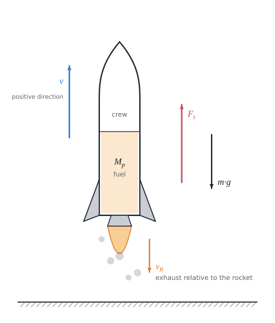

# Motion of a rocket

Theory for the calculation, in our own words. Kalketa verifies the formulas in the frames as derivations.



## A body of variable mass

A rocket has nothing to push off from: it accelerates by throwing exhaust gas out behind it. The total momentum of the rocket and the gas changes only by the action of external forces (weight). So we cannot write Newton's second law as F = m·a for the rocket alone, because its mass decreases during the flight. The momentum balance must be set up for a short time dt.

## The Meshchersky equation

At time t the rocket has mass m and velocity v. In time dt it expels exhaust gas of mass dμ, which flies away from it backward at the exhaust velocity v_R, that is at velocity v − v_R relative to the Earth. The rocket itself gains an increment of velocity dv. The change of momentum of the system equals the impulse of the weight:

```kalk
relation (m - dμ)·(v + dv) + dμ·(v - v_R) - m·v == -m·g·dt
derive m·dv - dμ·v_R - dμ·dv == -m·g·dt
```

The product dμ·dv is a small quantity of higher order, we neglect it. The mass of the rocket changes by dm = −dμ. After dividing by dt we get the Meshchersky equation:

```kalk
relation m·dv - dμ·v_R == -m·g·dt
relation dm == -dμ
derive m·dv/dt == -m·g - v_R·dm/dt
```

The term −v_R·dm/dt is positive (dm < 0) and acts as a force: it is the **thrust of the engine**.

## Thrust of the engine

If the engine burns at a constant consumption per second q (kg/s), then dm/dt = −q and the thrust is the product of the consumption and the exhaust velocity. The acceleration of the rocket is then:

```kalk
relation m·dv/dt == -m·g - v_R·dm/dt
relation dm/dt == -q
relation F_t == q·v_R
derive dv/dt == F_t/m - g
```

- With constant consumption the thrust is constant and the mass decreases: the acceleration grows during the flight and is greatest just before the fuel runs out.
- For the rocket to lift off at all, the thrust must exceed the weight of the full rocket: F_t > (M_r + M_p)·g.

## The Tsiolkovsky equation

We divide the Meshchersky equation by m and add up the increments of velocity over the whole burn time τ. The mass decreases from the initial m₀ (rocket with fuel) to the final m_k (rocket without fuel):

```kalk
derive v_R·integral(1/m, m: m_k .. m_0) - g·τ == v_R·ln(m_0/m_k) - g·τ
```

The result v_max − v₀ = v_R·ln(m₀/m_k) − g·τ is the Tsiolkovsky equation with gravity loss:

- **v_R·ln(m₀/m_k)** is the velocity of an ideal rocket in free space. It depends only on the exhaust velocity and on the mass ratio, not on how fast the fuel burns.
- **g·τ** is the gravity loss: during the whole burn the weight slows the rocket. This is why it pays to burn the fuel fast, if the crew and the structure can bear it.

## Gravity loss in the problem

With the consumption limited by the acceleration n·g at the end of the burn, the gravity loss comes out independent of g:

```kalk
relation τ == M_p/q
relation q == (n + 1)·g·M_r/v_R
derive g·τ == M_p·v_R/((n + 1)·M_r)
```

For the rocket of the problem (12 t of fuel, 2 t of structure, 5000 km/h, n = 7) the loss is 12 000·5000/(8·2000) = 3750 km/h. An ideal rocket would reach 5000·ln 7 ≐ 9730 km/h, the real one only about 5980 km/h.

## Acceleration and g-load

The problem statement limits the acceleration of the rocket relative to the Earth to 7 g. But the crew also feels its own weight: the seat presses on them with the force m·(a + g). They therefore feel (a + g)/g = n + 1, eight times their weight. Aviation and space standards usually limit exactly this g-load; with a limit of 7 g for the g-load the consumption would come out one eighth smaller.

## Why rockets have several stages

The logarithm grows slowly: to double the velocity of an ideal rocket the mass ratio must be squared (ln 49 = 2·ln 7). The structure of the empty tanks is also carried to the very end. A multistage rocket drops the burnt-out stages, each next stage starts with a smaller dead mass and the velocities of the stages add up.

## Assumptions of the calculation

- The rocket starts and flies vertically upward, the gravitational acceleration is constant (the burnout height of about 44 km is small compared with the radius of the Earth).
- Air resistance is neglected; in reality it is considerable in the dense atmosphere.
- The exhaust velocity and the consumption per second are constant during the whole burn.
