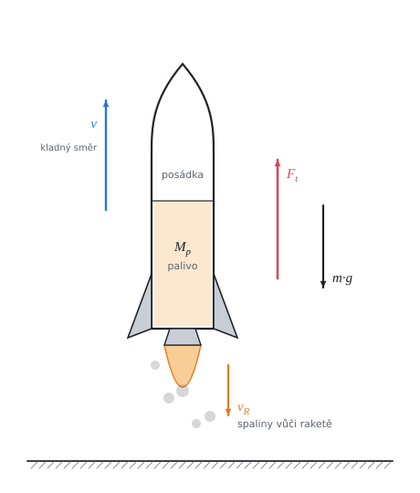

# Pohyb rakety

Teorie k výpočtu, vlastními slovy. Vzorce v rámečcích Kalketa ověřuje jako odvození.



## Těleso s proměnnou hmotností

Raketa se nemá od čeho odrazit: zrychluje tím, že za sebe vyhazuje spaliny. Celková hybnost rakety a spalin se mění jen působením vnějších sil (tíhy). Proto nelze psát druhý Newtonův zákon jako F = m·a pro raketu samotnou, její hmotnost během letu ubývá. Bilanci hybnosti je třeba sestavit pro krátký čas dt.

## Meščerského rovnice

V čase t má raketa hmotnost m a rychlost v. Za čas dt vyhodí spaliny o hmotnosti dμ, které od ní odlétají výtokovou rychlostí v_R dozadu, tedy rychlostí v − v_R vzhledem k Zemi. Raketa sama získá přírůstek rychlosti dv. Změna hybnosti soustavy se rovná impulsu tíhy:

```kalk
relation (m - dμ)·(v + dv) + dμ·(v - v_R) - m·v == -m·g·dt
derive m·dv - dμ·v_R - dμ·dv == -m·g·dt
```

Součin dμ·dv je malý vyšší řád, zanedbáme ho. Hmotnost rakety se mění o dm = −dμ. Po vydělení dt vznikne Meščerského rovnice:

```kalk
relation m·dv - dμ·v_R == -m·g·dt
relation dm == -dμ
derive m·dv/dt == -m·g - v_R·dm/dt
```

Člen −v_R·dm/dt je kladný (dm < 0) a působí jako síla: je to **tah motoru**.

## Tah motoru

Spaluje-li motor stálou sekundovou spotřebou q (kg/s), je dm/dt = −q a tah je součin spotřeby a výtokové rychlosti. Zrychlení rakety pak je:

```kalk
relation m·dv/dt == -m·g - v_R·dm/dt
relation dm/dt == -q
relation F_t == q·v_R
derive dv/dt == F_t/m - g
```

- Tah je při stálé spotřebě stálý, hmotnost ubývá: zrychlení během letu roste a největší je těsně před vyhořením paliva.
- Aby se raketa vůbec zvedla, musí tah převýšit tíhu plné rakety: F_t > (M_r + M_p)·g.

## Ciolkovského rovnice

Meščerského rovnici vydělíme m a sečteme přírůstky rychlosti za celou dobu hoření τ. Hmotnost přitom klesne z počáteční m₀ (raketa s palivem) na konečnou m_k (raketa bez paliva):

```kalk
derive v_R·integral(1/m, m: m_k .. m_0) - g·τ == v_R·ln(m_0/m_k) - g·τ
```

Výsledek v_max − v₀ = v_R·ln(m₀/m_k) − g·τ je Ciolkovského rovnice se ztrátou tíhou:

- **v_R·ln(m₀/m_k)** je rychlost ideální rakety ve volném prostoru. Závisí jen na výtokové rychlosti a na poměru hmotností, ne na tom, jak rychle palivo shoří.
- **g·τ** je ztráta tíhou: po celou dobu hoření tíha raketu brzdí. Proto se palivo vyplatí spálit rychle, pokud to posádka a konstrukce snesou.

## Ztráta tíhou v úloze

Při spotřebě omezené zrychlením n·g na konci hoření vyjde ztráta tíhou nezávislá na g:

```kalk
relation τ == M_p/q
relation q == (n + 1)·g·M_r/v_R
derive g·τ == M_p·v_R/((n + 1)·M_r)
```

Pro raketu z úlohy (12 t paliva, 2 t konstrukce, 5000 km/h, n = 7) je ztráta 12 000·5000/(8·2000) = 3750 km/h. Ideální raketa by dosáhla 5000·ln 7 ≐ 9730 km/h, skutečná jen asi 5980 km/h.

## Zrychlení a přetížení

Zadání omezuje zrychlení rakety vůči Zemi na 7 g. Posádka ale vnímá i svou tíhu: sedačka na ni tlačí silou m·(a + g). Pocítí tedy (a + g)/g = n + 1, osminásobek své tíhy. Letecké a kosmické normy obvykle omezují právě toto přetížení; s mezí 7 g pro přetížení by spotřeba vyšla o osminu menší.

## Proč rakety mají více stupňů

Logaritmus roste pomalu: k dvojnásobné rychlosti ideální rakety je třeba umocnit poměr hmotností na druhou (ln 49 = 2·ln 7). Konstrukce prázdných nádrží se navíc veze až do konce. Vícestupňová raketa odhazuje vyhořelé stupně, každý další stupeň začíná s menší mrtvou hmotností a rychlosti stupňů se sčítají.

## Předpoklady výpočtu

- Raketa startuje a letí svisle vzhůru, tíhové zrychlení je stálé (výška dohoření asi 44 km je malá proti poloměru Země).
- Odpor vzduchu zanedbáváme; ve skutečnosti je v husté atmosféře značný.
- Výtoková rychlost a sekundová spotřeba jsou po celou dobu hoření stálé.
