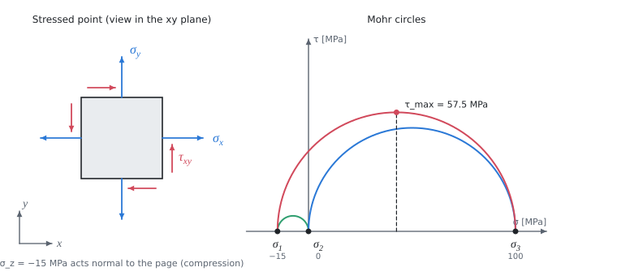

# Triaxial stress and strength hypotheses

The theory behind the calculation, in our own words. Kalketa checks the formulas in the boxes.



## Principal stresses

The state of stress at a point is described by the symmetric stress tensor T. There are three mutually perpendicular directions in which the shear stresses vanish; the normal stresses in them are the **principal stresses** and they are the eigenvalues of T. They solve det(T − σ·E) = 0, a cubic in σ. If τ_yz = τ_zx = 0, then σ_z is already a principal stress and the other two are the roots of the plane stress problem:

```kalk
σ_x := 80 MPa
σ_y := 20 MPa
τ_xy := 40 MPa
σ_a := (σ_x + σ_y)/2 + sqrt((σ_x - σ_y)^2/4 + τ_xy^2)
σ_b := (σ_x + σ_y)/2 - sqrt((σ_x - σ_y)^2/4 + τ_xy^2)
check "Plane stress gives 100 and 0 MPa": abs(σ_a - 100 MPa) ≤ 1e-9 MPa and abs(σ_b) ≤ 1e-9 MPa
check "The sum of the principal stresses is the trace of the tensor": abs(σ_a + σ_b - σ_x - σ_y) ≤ 1e-9 MPa
```

## Mohr circles

For a triaxial state, three circles are drawn in the (σ, τ) plane, each over the difference of two principal stresses. Half the differences are the shear stresses in the planes that bisect pairs of principal directions. The largest of them is the maximum shear stress at the point:

```kalk
τ_max := (100 MPa - (-15 MPa))/2
check "Radius of the largest circle": abs(τ_max - 57.5 MPa) ≤ 1e-9 MPa
```

## Strength hypotheses

The strength of a material is found by a tensile test, that is in uniaxial stress. A hypothesis turns a complicated state of stress into an **equivalent stress**: the uniaxial stress that would load the material just as dangerously. Then σ_RED ≤ σ_DOV is enough.

- **Guest (maximum shear stress)**: the largest shear stress is what matters. In uniaxial tension σ it is τ_max = σ/2, so σ_RED = 2·τ_max = the largest difference of principal stresses.
- **HMH (von Mises, distortion energy)**: what matters is the part of the elastic strain energy that changes the shape (not the volume). It gives σ_RED = √(σ₁² + σ₂² + σ₃² − σ₁σ₂ − σ₂σ₃ − σ₃σ₁).

Both hypotheses are for ductile metals and do not depend on how the principal stresses are numbered. HMH can also be written directly with the components of the tensor, without finding the principal stresses, because it is expressed by invariants:

```kalk
σ_x := 80 MPa
σ_y := 20 MPa
σ_z := -15 MPa
τ_xy := 40 MPa
σ_1 := -15 MPa
σ_2 := 0 MPa
σ_3 := 100 MPa
h1 := sqrt(σ_1^2 + σ_2^2 + σ_3^2 - σ_1·σ_2 - σ_2·σ_3 - σ_3·σ_1)
h2 := sqrt(σ_x^2 + σ_y^2 + σ_z^2 - σ_x·σ_y - σ_y·σ_z - σ_z·σ_x + 3·τ_xy^2)
check "HMH from the components and from the principal stresses is the same": abs(h1 - h2) ≤ 1e-9 MPa
check "HMH is about 108.28 MPa": abs(h1 - 108.28 MPa) ≤ 0.005 MPa
```

Guest's hypothesis is always at least as strict as HMH: the largest difference of principal stresses is at least as large as the HMH equivalent stress and at most 15.5 % larger (the ratio 2/√3 occurs in pure shear). So a state of stress can pass by HMH and fail by Guest, as here.
