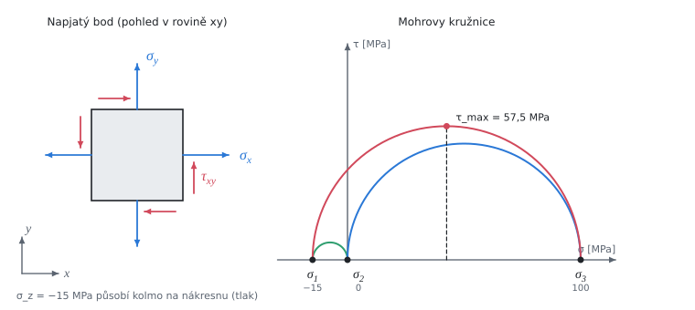

# Prostorová napjatost a hypotézy pevnosti

Teorie k výpočtu, vlastními slovy. Vzorce v rámečcích Kalketa ověřuje.



## Hlavní napětí

Napjatost v bodě popisuje symetrický tenzor napětí T. Existují tři na sebe kolmé směry, ve kterých jsou smyková napětí nulová; normálová napětí v nich jsou **hlavní napětí** a jsou to vlastní čísla T. Řeší se rovnice det(T − σ·E) = 0, kubická v σ. Je-li τ_yz = τ_zx = 0, je σ_z už hlavní napětí a zbylá dvě jsou kořeny rovinné napjatosti:

```kalk
σ_x := 80 MPa
σ_y := 20 MPa
τ_xy := 40 MPa
σ_a := (σ_x + σ_y)/2 + sqrt((σ_x - σ_y)^2/4 + τ_xy^2)
σ_b := (σ_x + σ_y)/2 - sqrt((σ_x - σ_y)^2/4 + τ_xy^2)
check "Rovinná napjatost dá 100 a 0 MPa": abs(σ_a - 100 MPa) ≤ 1e-9 MPa and abs(σ_b) ≤ 1e-9 MPa
check "Součet hlavních napětí je stopa tenzoru": abs(σ_a + σ_b - σ_x - σ_y) ≤ 1e-9 MPa
```

## Mohrovy kružnice

U prostorové napjatosti se do roviny (σ, τ) kreslí tři kružnice, každá nad rozdílem dvou hlavních napětí. Poloviny rozdílů jsou smyková napětí v rovinách, které půlí dvojice hlavních směrů. Největší z nich je největší smykové napětí v bodě:

```kalk
τ_max := (100 MPa - (-15 MPa))/2
check "Poloměr největší kružnice": abs(τ_max - 57.5 MPa) ≤ 1e-9 MPa
```

## Hypotézy pevnosti

Pevnost materiálu se zjistí zkouškou tahem, tedy jednoosou napjatostí. Hypotéza převede složitou napjatost na **redukované napětí**: jednoosé napětí, které by materiál namáhalo stejně nebezpečně. Pak stačí σ_RED ≤ σ_DOV.

- **Guest (největší smykové napětí)**: nebezpečné je největší smykové napětí. Při jednoosém tahu σ je τ_max = σ/2, takže σ_RED = 2·τ_max = největší rozdíl hlavních napětí.
- **HMH (von Mises, energie změny tvaru)**: nebezpečná je část energie pružné deformace, která mění tvar (ne objem). Vyjde σ_RED = √(σ₁² + σ₂² + σ₃² − σ₁σ₂ − σ₂σ₃ − σ₃σ₁).

Obě hypotézy jsou pro tvárné kovy a nezávisí na tom, jak se hlavní napětí číslují. HMH jde psát i přímo ze složek tenzoru, bez hledání hlavních napětí, protože je vyjádřená invarianty:

```kalk
σ_x := 80 MPa
σ_y := 20 MPa
σ_z := -15 MPa
τ_xy := 40 MPa
σ_1 := -15 MPa
σ_2 := 0 MPa
σ_3 := 100 MPa
h1 := sqrt(σ_1^2 + σ_2^2 + σ_3^2 - σ_1·σ_2 - σ_2·σ_3 - σ_3·σ_1)
h2 := sqrt(σ_x^2 + σ_y^2 + σ_z^2 - σ_x·σ_y - σ_y·σ_z - σ_z·σ_x + 3·τ_xy^2)
check "HMH ze složek a z hlavních napětí je totéž": abs(h1 - h2) ≤ 1e-9 MPa
check "HMH je asi 108,28 MPa": abs(h1 - 108.28 MPa) ≤ 0.005 MPa
```

Guestova hypotéza je vždy aspoň tak přísná jako HMH: největší rozdíl hlavních napětí je nejméně tak velký jako HMH redukované napětí a nejvýš o 15,5 % větší (poměr 2/√3 je největší hodnota při čistém smyku). Proto napjatost může projít podle HMH a neprojít podle Guesta, jako tady.
