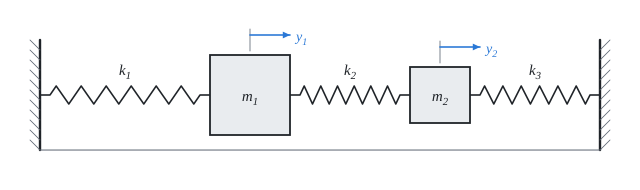

# Vibration of systems with several degrees of freedom

The theory behind the calculation, in our own words. Kalketa checks the formulas in the boxes as derivations.



## Equations of motion

The displacements y₁ and y₂ are measured from the equilibrium position. A spring between two points acts with a force proportional to the difference of their displacements. The first mass is acted on by the spring k₁ (wall) and k₂ (second mass), the second by k₂ and k₃:

```kalk
relation m_1·a_1 == -k_1·y_1 - k_2·(y_1 - y_2)
relation m_2·a_2 == -k_2·(y_2 - y_1) - k_3·y_2
derive a_1 == (k_2·y_2 - (k_1 + k_2)·y_1)/m_1
```

In matrix form M·ÿ + K·y = 0 with the mass matrix M = diag(m₁, m₂) and the stiffness matrix

K = [k₁ + k₂, −k₂ | −k₂, k₂ + k₃].

The stiffness matrix is symmetric: the force with which the spring k₂ pushes the first mass is the same as the one with which it pushes the second.

## Natural frequencies

We look for a motion in which both masses vibrate with the same frequency: y = φ·cos(ω·t). Substituting (ÿ = −ω²·y) gives (K − ω²·M)·φ = 0. A nonzero φ exists only when the determinant is zero; for two masses this is a quadratic equation for Ω = ω²:

```kalk
relation (k_1 + k_2 - m_1·Ω)·(k_2 + k_3 - m_2·Ω) - k_2^2 == 0
```

For the given values the equation has nice roots, which can be checked by substitution:

```kalk
m_1 := 9 kg
m_2 := 1 kg
k_1 := 38 N/m
k_2 := 2 N/m
k_3 := 3 N/m
Ω_a := 4 s^-2
Ω_b := 49 s^-2/9
check "Ω = 4 s⁻² is a root": abs((k_1 + k_2 - m_1·Ω_a)·(k_2 + k_3 - m_2·Ω_a) - k_2^2) ≤ 1e-9 N^2/m^2
check "Ω = 49/9 s⁻² is a root": abs((k_1 + k_2 - m_1·Ω_b)·(k_2 + k_3 - m_2·Ω_b) - k_2^2) ≤ 1e-9 N^2/m^2
```

So the natural angular frequencies are ω₁ = 2 rad/s and ω₂ = 7/3 rad/s. For larger systems the equation is not solved by hand: it is the generalized eigenvalue problem K·φ = Ω·M·φ (in Kalketa `eigenvals(K, M)` and `eigenvecs(K, M)`).

## Mode shapes

Each natural frequency has a mode shape: the ratio of the amplitudes of the two masses. The first row of (K − Ω·M)·φ = 0 gives:

```kalk
relation (k_1 + k_2 - m_1·Ω)·φ_1 - k_2·φ_2 == 0
derive φ_2/φ_1 == (k_1 + k_2 - m_1·Ω)/k_2
```

- Ω = 4 s⁻²: φ₂/φ₁ = (40 − 36)/2 = 2. The masses move in the same direction, the lighter second one twice as much.
- Ω = 49/9 s⁻²: φ₂/φ₁ = (40 − 49)/2 = −4.5. The masses move against each other.

A higher mode has more changes of direction; this holds in general for systems with several degrees of freedom.

## Free vibration: a sum of modes

The general motion without excitation is the sum of the mode shapes, each with its own frequency. Without an initial velocity:

y(t) = C₁·φ₁·cos(ω₁·t) + C₂·φ₂·cos(ω₂·t)

The amplitudes C₁, C₂ follow from the initial displacements: Φ·C = y(0), where Φ has the mode shapes as columns. For y(0) = [1, 0] with the modes [1, 2] and [1, −4.5]:

```kalk
Φ := [1, 1 | 2, -4.5]
C := lsolve(Φ, [1, 0])
check "C₁ = 9/13": abs(C[1] - 9/13) ≤ 1e-12
check "C₂ = 4/13": abs(C[2] - 4/13) ≤ 1e-12
```

## Beats

When the natural frequencies are close to each other, the sum of two cosines behaves like a vibration of the mean frequency with a slowly changing amplitude. The energy flows from one mass to the other and back; the period of the envelope (of the beats) is

```kalk
relation T_r == 2·π/(ω_2 - ω_1)
```

for the given system 2π/(1/3) ≐ 18.85 s. The second mass is at rest at first, it starts to vibrate through the spring k₂ and after half a beat period it is the one vibrating, while the first almost stops.

## Assumptions of the calculation

- The masses are rigid and move only along a line, without friction and damping.
- The springs are linear and massless.
- The source gives no units; the calculation takes kg, N/m and m.
