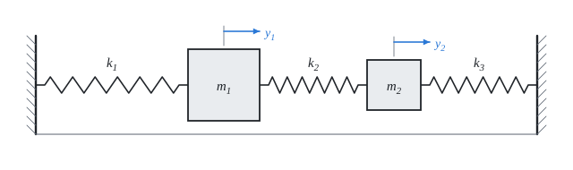

# Kmitání soustav s více stupni volnosti

Teorie k výpočtu, vlastními slovy. Vzorce v rámečcích Kalketa ověřuje jako odvození.



## Pohybové rovnice

Výchylky y₁ a y₂ měříme od rovnovážné polohy. Pružina mezi dvěma body působí silou úměrnou rozdílu jejich výchylek. Na první hmotu působí pružina k₁ (stěna) a k₂ (druhá hmota), na druhou k₂ a k₃:

```kalk
relation m_1·a_1 == -k_1·y_1 - k_2·(y_1 - y_2)
relation m_2·a_2 == -k_2·(y_2 - y_1) - k_3·y_2
derive a_1 == (k_2·y_2 - (k_1 + k_2)·y_1)/m_1
```

V maticovém tvaru M·ÿ + K·y = 0 s maticí hmotnosti M = diag(m₁, m₂) a maticí tuhosti

K = [k₁ + k₂, −k₂ | −k₂, k₂ + k₃].

Matice tuhosti je souměrná: síla, kterou pružina k₂ tlačí první hmotu, je stejná jako ta, kterou tlačí druhou.

## Vlastní frekvence

Hledáme pohyb, při kterém kmitají obě hmoty stejnou frekvencí: y = φ·cos(ω·t). Dosazením (ÿ = −ω²·y) vznikne (K − ω²·M)·φ = 0. Nenulové φ existuje, jen když je determinant nulový; pro dvě hmoty je to kvadratická rovnice pro Ω = ω²:

```kalk
relation (k_1 + k_2 - m_1·Ω)·(k_2 + k_3 - m_2·Ω) - k_2^2 == 0
```

Pro zadané hodnoty má rovnice pěkné kořeny, které jde ověřit dosazením:

```kalk
m_1 := 9 kg
m_2 := 1 kg
k_1 := 38 N/m
k_2 := 2 N/m
k_3 := 3 N/m
Ω_a := 4 s^-2
Ω_b := 49 s^-2/9
check "Ω = 4 s⁻² je kořen": abs((k_1 + k_2 - m_1·Ω_a)·(k_2 + k_3 - m_2·Ω_a) - k_2^2) ≤ 1e-9 N^2/m^2
check "Ω = 49/9 s⁻² je kořen": abs((k_1 + k_2 - m_1·Ω_b)·(k_2 + k_3 - m_2·Ω_b) - k_2^2) ≤ 1e-9 N^2/m^2
```

Vlastní úhlové frekvence jsou tedy ω₁ = 2 rad/s a ω₂ = 7/3 rad/s. Pro větší soustavy se rovnice neřeší rukou: je to zobecněná úloha vlastních čísel K·φ = Ω·M·φ (v Kalketě `eigenvals(K, M)` a `eigenvecs(K, M)`).

## Tvary kmitů

Ke každé vlastní frekvenci patří tvar kmitu: poměr amplitud obou hmot. Z prvního řádku (K − Ω·M)·φ = 0 plyne:

```kalk
relation (k_1 + k_2 - m_1·Ω)·φ_1 - k_2·φ_2 == 0
derive φ_2/φ_1 == (k_1 + k_2 - m_1·Ω)/k_2
```

- Ω = 4 s⁻²: φ₂/φ₁ = (40 − 36)/2 = 2. Hmoty se pohybují stejným směrem, lehčí druhá dvojnásobně.
- Ω = 49/9 s⁻²: φ₂/φ₁ = (40 − 49)/2 = −4,5. Hmoty se pohybují proti sobě.

Vyšší tvar má víc změn směru; to platí obecně pro soustavy s více stupni volnosti.

## Volné kmitání: součet tvarů

Obecný pohyb bez buzení je součtem tvarů kmitů, každý se svou frekvencí. Bez počáteční rychlosti:

y(t) = C₁·φ₁·cos(ω₁·t) + C₂·φ₂·cos(ω₂·t)

Amplitudy C₁, C₂ plynou z počátečních výchylek: Φ·C = y(0), kde Φ má tvary jako sloupce. Pro y(0) = [1, 0] s tvary [1, 2] a [1, −4,5]:

```kalk
Φ := [1, 1 | 2, -4.5]
C := lsolve(Φ, [1, 0])
check "C₁ = 9/13": abs(C[1] - 9/13) ≤ 1e-12
check "C₂ = 4/13": abs(C[2] - 4/13) ≤ 1e-12
```

## Rázy

Jsou-li vlastní frekvence blízko sebe, součet dvou kosinů se chová jako kmit střední frekvence s pomalu se měnící amplitudou. Energie se přelévá z jedné hmoty na druhou a zpět; perioda obálky (rázů) je

```kalk
relation T_r == 2·π/(ω_2 - ω_1)
```

pro zadanou soustavu 2π/(1/3) ≐ 18,85 s. Druhá hmota v první chvíli stojí, rozkmitá se přes pružinu k₂ a po polovině periody rázů kmitá ona, zatímco první se téměř zastaví.

## Předpoklady výpočtu

- Hmoty jsou tuhé a pohybují se jen po přímce, bez tření a tlumení.
- Pružiny jsou lineární a nehmotné.
- Zdroj neuvádí jednotky; výpočet bere kg, N/m a m.

## Ověření v Pythonu

Jiná cesta k týmž výsledkům: vlastní čísla matice M⁻¹·K z charakteristické rovnice, tvary z prvního řádku, pohyb simulovaný krok po kroku (Rungeova–Kuttova metoda) a porovnaný s rozkladem do tvarů.

```python
from math import pi, sqrt, cos

m1, m2, k1, k2, k3 = 9.0, 1.0, 38.0, 2.0, 3.0
# Characteristic equation m1 m2 Ω² − (m1 (k2+k3) + m2 (k1+k2)) Ω + (k1+k2)(k2+k3) − k2² = 0
a = m1 * m2
b = -(m1 * (k2 + k3) + m2 * (k1 + k2))
c = (k1 + k2) * (k2 + k3) - k2**2
d = sqrt(b * b - 4 * a * c)
O1, O2 = (-b - d) / (2 * a), (-b + d) / (2 * a)
w1, w2 = sqrt(O1), sqrt(O2)
r1 = (k1 + k2 - m1 * O1) / k2
r2 = (k1 + k2 - m1 * O2) / k2

# Free vibration from y = [1, 0], simulated with RK4 and compared with the sum of the modes at t = 7 s.
def acc(y):
    return [(-(k1 + k2) * y[0] + k2 * y[1]) / m1, (k2 * y[0] - (k2 + k3) * y[1]) / m2]

y, v, dt, t = [1.0, 0.0], [0.0, 0.0], 0.0005, 0.0
while t < 7.0 - 1e-12:
    def f(state):
        yy, vv = state
        return [vv, acc(yy)]
    s0 = [y, v]
    k_1 = f(s0)
    k_2 = f([[y[i] + dt / 2 * k_1[0][i] for i in range(2)], [v[i] + dt / 2 * k_1[1][i] for i in range(2)]])
    k_3 = f([[y[i] + dt / 2 * k_2[0][i] for i in range(2)], [v[i] + dt / 2 * k_2[1][i] for i in range(2)]])
    k_4 = f([[y[i] + dt * k_3[0][i] for i in range(2)], [v[i] + dt * k_3[1][i] for i in range(2)]])
    y = [y[i] + dt / 6 * (k_1[0][i] + 2 * k_2[0][i] + 2 * k_3[0][i] + k_4[0][i]) for i in range(2)]
    v = [v[i] + dt / 6 * (k_1[1][i] + 2 * k_2[1][i] + 2 * k_3[1][i] + k_4[1][i]) for i in range(2)]
    t += dt
C1, C2 = 9 / 13, 4 / 13
modes = C1 * cos(w1 * 7) + C2 * cos(w2 * 7)
print("y1(7 s): simulation", round(y[0], 9), "modes", round(modes, 9))

result("ω_1", w1, "rad/s")
result("ω_2", w2, "rad/s")
result("f_1", w1 / (2 * pi), "Hz")
result("f_2", w2 / (2 * pi), "Hz")
result("r_1", r1, "")
result("r_2", r2, "")
result("T_r", 2 * pi / (w2 - w1), "s")
```
