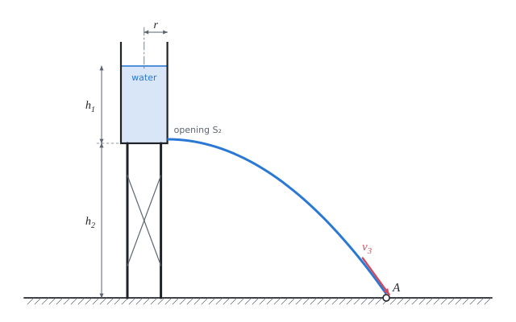

# Outflow of a liquid from a vessel

The theory behind the calculation, in our own words. Kalketa checks the formulas in the boxes as derivations.



## The Bernoulli equation

For an ideal liquid (incompressible, without internal friction) in steady flow, the sum of the pressure, the gravitational potential energy and the kinetic energy per unit volume does not change along a streamline:

```kalk
relation p + ρ·g·y + ρ·v^2/2 == c
```

- p is the pressure in the liquid, y the height above a chosen zero plane, v the flow speed, ρ the density, g the gravitational acceleration.
- Every term has the dimension of pressure (Pa = J/m³): it is an energy density. So the equation is the law of conservation of energy for a flowing liquid.
- Between two places 1 and 2 of the same streamline: p₁ + ρ·g·y₁ + ½·ρ·v₁² = p₂ + ρ·g·y₂ + ½·ρ·v₂².

## The continuity equation

An incompressible liquid does not accumulate anywhere: as much of it flows through one cross-section of a stream tube as through every other. The volume flow rate Q is constant:

```kalk
relation Q == S_1·v_1
relation Q == S_2·v_2
derive S_1·v_1 == S_2·v_2
```

Where the stream tube narrows, the liquid flows faster. The surface of a wide tank therefore falls very slowly compared with the speed at which the water flows out through a small opening.

## Torricelli's formula

Outflow through a small opening at depth h below the surface: at the surface and in the opening there is atmospheric pressure, the surface almost stands still (the tank is much wider than the opening). The Bernoulli equation for the surface and for the opening gives the outflow speed:

```kalk
relation p_a + ρ·g·(y_0 + h) == p_a + ρ·g·y_0 + ρ·v^2/2
derive v == sqrt(2·g·h)
```

It is the same speed that a drop would gain by free fall from the height h. The outflow speed does not depend on the density of the liquid or on the shape of the tank, only on the depth of the opening below the surface.

## Time to empty a cylindrical vessel

As the surface falls, the outflow weakens. In the time dt the surface falls by dh (dh < 0) and the volume S₁·(−dh) is lost; the same volume flows out through the opening: S₂·√(2·g·h)·dt. Separating the variables and integrating from the full vessel (height h) to the empty one:

```kalk
derive t := S_1/(S_2·sqrt(2·g))·2·sqrt(h) == S_1/S_2·sqrt(2·h/g)
```

If the water flowed out the whole time at the initial speed √(2·g·h), the vessel would be emptied in S₁·h / (S₂·√(2·g·h)). The real time is exactly twice that:

```kalk
derive S_1/S_2·sqrt(2·h/g) == 2·S_1·h/(S_2·sqrt(2·g·h))
```

So the first half of the height flows out faster than the second: the outflow is weakest near the bottom.

## Real outflow: the discharge coefficient

The formulas above hold for an ideal liquid. A real jet narrows further behind the opening (the narrowest place of the jet, the vena contracta) and part of the energy is lost to friction. Both are covered by the discharge coefficient μ:

```kalk
relation Q == μ·S_2·sqrt(2·g·h)
```

- For a small circular opening with a sharp edge in a thin wall, μ is about 0.6 to 0.62; for a short cylindrical nozzle about 0.82; for a well rounded nozzle up to 0.97.
- The time to empty is lengthened in the ratio 1/μ. The tank of the calculation (52.7 min without the coefficient) would be emptied through a sharp-edged opening in about 85 minutes.
- The collection of problems neglects the coefficient; a technical calculation must include it.

## Speed of impact another way: a horizontal projectile

The jet leaves the opening horizontally at the speed vₓ = √(2·g·h₁) and falls from the height h₂, where it gains the vertical speed v_y = √(2·g·h₂). The magnitude of the resulting speed at impact is the same as from the Bernoulli equation for the surface and the ground:

```kalk
derive sqrt((sqrt(2·g·h_1))^2 + (sqrt(2·g·h_2))^2) == sqrt(2·g·(h_1 + h_2))
```

## Assumptions of the calculation

- The liquid is ideal and incompressible, the flow is steady (the surface falls slowly, so every moment can be taken as a steady state).
- The atmospheric pressure is the same at the surface, at the opening and at the ground.
- The opening is small compared with the cross-section of the tank, the speed of the surface is neglected compared with the outflow speed.
