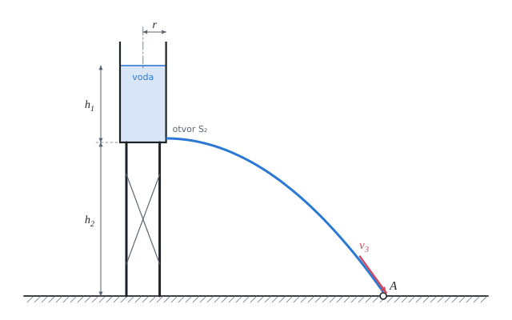

# Výtok kapaliny z nádoby

Teorie k výpočtu, vlastními slovy. Vzorce v rámečcích Kalketa ověřuje jako odvození.



## Bernoulliho rovnice

Pro ideální kapalinu (nestlačitelnou, bez vnitřního tření) při ustáleném proudění platí podél proudnice, že součet tlaku, tíhové potenciální energie a kinetické energie připadajících na jednotku objemu se nemění:

```kalk
relation p + ρ·g·y + ρ·v^2/2 == c
```

- p je tlak v kapalině, y výška nad zvolenou nulovou rovinou, v rychlost proudění, ρ hustota, g tíhové zrychlení.
- Každý člen má rozměr tlaku (Pa = J/m³): jde o hustotu energie. Rovnice je tedy zákon zachování energie pro proudící kapalinu.
- Mezi dvěma místy 1 a 2 téže proudnice: p₁ + ρ·g·y₁ + ½·ρ·v₁² = p₂ + ρ·g·y₂ + ½·ρ·v₂².

## Rovnice kontinuity

Nestlačitelná kapalina se nikde nehromadí: kolik jí proteče jedním průřezem trubice proudu, tolik jich proteče každým dalším. Objemový průtok Q je stálý:

```kalk
relation Q == S_1·v_1
relation Q == S_2·v_2
derive S_1·v_1 == S_2·v_2
```

Kde se trubice proudu zužuje, kapalina proudí rychleji. Hladina široké nádrže proto klesá velmi pomalu proti rychlosti, kterou voda vytéká malým otvorem.

## Torricelliho vzorec

Výtok malým otvorem ve hloubce h pod hladinou: na hladině i v otvoru je atmosférický tlak, hladina téměř stojí (nádrž je mnohem širší než otvor). Bernoulliho rovnice pro hladinu a pro otvor dává rychlost výtoku:

```kalk
relation p_a + ρ·g·(y_0 + h) == p_a + ρ·g·y_0 + ρ·v^2/2
derive v == sqrt(2·g·h)
```

Je to stejná rychlost, jakou by kapka získala volným pádem z výšky h. Výtoková rychlost nezávisí na hustotě kapaliny ani na tvaru nádrže, jen na hloubce otvoru pod hladinou.

## Doba vyprázdnění válcové nádoby

S klesající hladinou slábne výtok. Za čas dt klesne hladina o dh (dh < 0) a ubude objem S₁·(−dh); stejný objem vyteče otvorem: S₂·√(2·g·h)·dt. Oddělením proměnných a integrací od plné nádoby (výška h) do prázdné:

```kalk
derive t := S_1/(S_2·sqrt(2·g))·2·sqrt(h) == S_1/S_2·sqrt(2·h/g)
```

Kdyby voda vytékala celou dobu počáteční rychlostí √(2·g·h), nádoba by se vyprázdnila za S₁·h / (S₂·√(2·g·h)). Skutečná doba je právě dvojnásobná:

```kalk
derive S_1/S_2·sqrt(2·h/g) == 2·S_1·h/(S_2·sqrt(2·g·h))
```

Proto první polovina výšky vyteče rychleji než druhá: u dna je výtok nejslabší.

## Skutečný výtok: výtokový součinitel

Vzorce výše platí pro ideální kapalinu. Skutečný proud se za otvorem ještě zúží (nejužší místo proudu, vena contracta) a část energie se ztratí třením. Obojí zahrnuje výtokový součinitel μ:

```kalk
relation Q == μ·S_2·sqrt(2·g·h)
```

- Pro malý kruhový otvor s ostrou hranou v tenké stěně je μ přibližně 0,6 až 0,62; pro krátký válcový nástavec asi 0,82; pro dobře zaoblenou trysku až 0,97.
- Doba vyprázdnění se tím prodlouží v poměru 1/μ. Nádrž z výpočtu (bez součinitele 52,7 min) by se otvorem s ostrou hranou vyprazdňovala asi 85 minut.
- Sbírka součinitel zanedbává; pro technický výpočet ho je třeba zahrnout.

## Rychlost dopadu jinak: vodorovný vrh

Proud vytéká z otvoru vodorovně rychlostí vₓ = √(2·g·h₁) a padá z výšky h₂, kde získá svislou rychlost v_y = √(2·g·h₂). Velikost výsledné rychlosti při dopadu je stejná jako z Bernoulliho rovnice pro hladinu a zem:

```kalk
derive sqrt((sqrt(2·g·h_1))^2 + (sqrt(2·g·h_2))^2) == sqrt(2·g·(h_1 + h_2))
```

## Předpoklady výpočtu

- Kapalina je ideální a nestlačitelná, proudění je ustálené (hladina klesá pomalu, takže každý okamžik lze brát jako ustálený stav).
- Atmosférický tlak je na hladině, u otvoru i u země stejný.
- Otvor je malý proti průřezu nádrže, rychlost hladiny proti rychlosti výtoku zanedbáváme.
