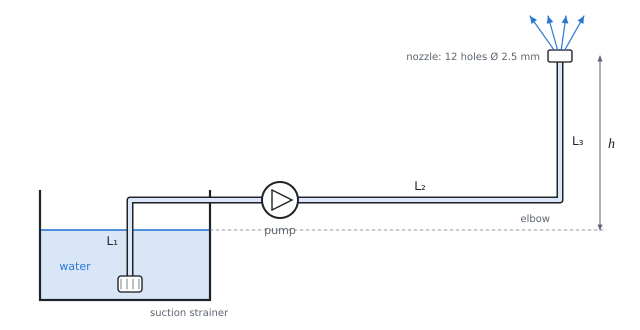

# Losses in flow through a pipe

The theory behind the calculation, in our own words. Kalketa checks the formulas in the boxes as derivations.



## Flow regime: the Reynolds number

The ratio of inertial and viscous forces in the flow is given by the Reynolds number. For a circular pipe of diameter D with the mean speed w:

```kalk
relation Re == ρ·w·D/η
relation ν == η/ρ
derive Re == w·D/ν
```

Up to Re ≐ 2300 the flow is laminar (the layers do not mix), above it turns turbulent. In the source and here Re is in the tens of thousands up to millions, so the flow is turbulent.

## Friction loss: the Darcy–Weisbach equation

The pressure loss by friction over the length L grows with the kinetic energy of the stream and with the length, and falls with the diameter; the friction factor λ is dimensionless:

```kalk
relation Δp == λ·L/D·ρ·w^2/2
relation e_z == Δp/ρ
derive e_z == λ·L/D·w^2/2
```

The energy loss e_z (J/kg) is the pressure loss per unit mass; it is used in the Bernoulli equation.

## Friction factor

**Laminar flow:** λ = 64/Re, independent of roughness.

**Hydraulically smooth pipe, the Blasius relation** (up to Re ≐ 10⁵):

```kalk
Re := 50000
λ := 0.3164/Re^(1/4)
check "Blasius for Re = 50000": abs(λ - 0.02116) ≤ 0.00001
```

**The Colebrook equation** holds in the whole turbulent region, for smooth and rough pipes. ε is the absolute roughness of the wall (steel about 0.05 mm, cast iron 0.25 mm):

```kalk
relation 1/sqrt(λ) == -2·log10(ε/(3.7·D) + 2.51/(Re·sqrt(λ)))
```

λ is on both sides, so the equation cannot be expressed by a formula; it is solved by iteration or from the Moody diagram. Kalketa solves it with a line `solve λ: …` with an interval. For very high Re the second term vanishes and λ stops depending on Re (the fully rough region):

```kalk
ε := 0.26 mm
D := 0.3 m
λ := (-2·log10(ε/(3.7·D)))^(-2)
check "Fully rough pipe ε/D ≐ 0.00087": abs(λ - 0.01897) ≤ 0.00001
```

## Local losses

Fittings (elbow, valve, suction strainer, nozzle) lose energy in proportion to the kinetic energy of the stream; the loss coefficient ξ is taken from the manufacturer's tables or from the literature. Losses in series add up:

```kalk
relation e_z == w^2/2·(ξ_1 + ξ_2 + ξ_3 + λ·L/D)
```

## The Bernoulli equation with a pump

Between the surface of the tank (0) and the nozzle outlet (1) the pump supplies the specific work e_č, which covers the losses, the kinetic energy of the outflowing water and the height. There is atmospheric pressure at the surface and at the outlet, the surface is at rest:

```kalk
relation w_0^2/2 + g·y_0 + p_0/ρ + e_č - e_z == w_1^2/2 + g·y_1 + p_1/ρ
relation w_0 == 0 m/s
relation p_0 == p_1
relation y_1 - y_0 == h
derive e_č == e_z + w_1^2/2 + g·h
```

The power delivered to the water is P = ρ·Q·e_č, the input power of the pump is larger by the efficiency: P_p = P/η_č.

## Parallel branches

Two branches with a common start and end have the same pressure drop; the flow divides between them so that this holds:

```kalk
relation λ_A·L_A/D·ρ·w_A^2/2 == λ_B·L_B/D·ρ·w_B^2/2
relation λ_A == λ_B
derive w_B == w_A·sqrt(L_A/L_B)
```

The assumption λ_A = λ_B is exact only in the fully rough region. Otherwise λ depends on the speed, which is yet to be found; a rigorous calculation solves the Colebrook equation and the equality of the losses as a system of two equations for w_B and λ_B.

## Assumptions of the calculation

- Steady flow of incompressible water, mean speed over the cross-section, kinetic energy coefficient 1.
- Loss coefficients of the fittings as given in the exercise; friction in all sections with the same λ (the same diameter).
- In the parallel branches local losses are neglected, as in the source.
