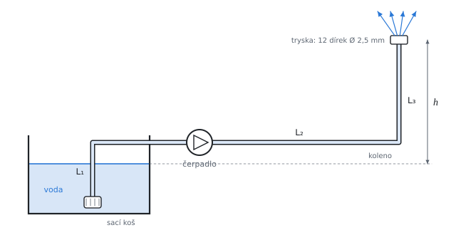

# Ztráty při proudění potrubím

Teorie k výpočtu, vlastními slovy. Vzorce v rámečcích Kalketa ověřuje jako odvození.



## Režim proudění: Reynoldsovo číslo

Poměr setrvačných a vazkých sil v proudu udává Reynoldsovo číslo. Pro kruhové potrubí průměru D se střední rychlostí w:

```kalk
relation Re == ρ·w·D/η
relation ν == η/ρ
derive Re == w·D/ν
```

Do Re ≐ 2 300 je proudění laminární (vrstvy se nemísí), nad ním přechází v turbulentní. Ve zdroji i zde je Re v řádu desítek tisíc až milionů, proudění je tedy turbulentní.

## Ztráta třením: Darcyho–Weisbachova rovnice

Tlaková ztráta třením na délce L roste s kinetickou energií proudu a délkou, klesá s průměrem; součinitel tření λ je bezrozměrný:

```kalk
relation Δp == λ·L/D·ρ·w^2/2
relation e_z == Δp/ρ
derive e_z == λ·L/D·w^2/2
```

Ztrátová energie e_z (J/kg) je ztráta tlaku na jednotku hmotnosti; s ní se počítá v Bernoulliho rovnici.

## Součinitel tření

**Laminární proudění:** λ = 64/Re, nezávisle na drsnosti.

**Hydraulicky hladké potrubí, Blasiův vztah** (do Re ≐ 10⁵):

```kalk
Re := 50000
λ := 0.3164/Re^(1/4)
check "Blasius pro Re = 50 000": abs(λ - 0.02116) ≤ 0.00001
```

**Colebrookova rovnice** platí v celé turbulentní oblasti, pro hladké i drsné potrubí. ε je absolutní drsnost stěny (ocel kolem 0,05 mm, litina 0,25 mm):

```kalk
relation 1/sqrt(λ) == -2·log10(ε/(3.7·D) + 2.51/(Re·sqrt(λ)))
```

λ je na obou stranách, rovnici tedy nejde vyjádřit vzorcem; řeší se iterací nebo z Moodyho diagramu. Kalketa ji řeší řádkem `solve λ: …` s intervalem. Pro velmi vysoká Re zmizí druhý člen a λ přestane záviset na Re (zcela drsná oblast):

```kalk
ε := 0.26 mm
D := 0.3 m
λ := (-2·log10(ε/(3.7·D)))^(-2)
check "Zcela drsné potrubí ε/D ≐ 0,00087": abs(λ - 0.01897) ≤ 0.00001
```

## Místní ztráty

Tvarovky (koleno, ventil, sací koš, tryska) ztrácejí energii v poměru ke kinetické energii proudu; ztrátový součinitel ξ se bere z tabulek výrobce nebo literatury. Ztráty v sérii se sčítají:

```kalk
relation e_z == w^2/2·(ξ_1 + ξ_2 + ξ_3 + λ·L/D)
```

## Bernoulliho rovnice s čerpadlem

Mezi hladinou nádrže (0) a výstupem z trysky (1) dodá čerpadlo měrnou práci e_č, která pokryje ztráty, kinetickou energii vytékající vody a výšku. Na hladině i na výstupu je atmosférický tlak, hladina stojí:

```kalk
relation w_0^2/2 + g·y_0 + p_0/ρ + e_č - e_z == w_1^2/2 + g·y_1 + p_1/ρ
relation w_0 == 0 m/s
relation p_0 == p_1
relation y_1 - y_0 == h
derive e_č == e_z + w_1^2/2 + g·h
```

Výkon předaný vodě je P = ρ·Q·e_č, příkon čerpadla je o účinnost větší: P_p = P/η_č.

## Paralelní větve

Dvě větve se společným začátkem i koncem mají stejný tlakový spád; průtok se mezi ně rozdělí tak, aby to platilo:

```kalk
relation λ_A·L_A/D·ρ·w_A^2/2 == λ_B·L_B/D·ρ·w_B^2/2
relation λ_A == λ_B
derive w_B == w_A·sqrt(L_A/L_B)
```

Předpoklad λ_A = λ_B je přesný jen ve zcela drsné oblasti. Jinak λ závisí na rychlosti, která teprve vyjde; poctivý výpočet řeší Colebrookovu rovnici a rovnost ztrát jako soustavu dvou rovnic pro w_B a λ_B.

## Předpoklady výpočtu

- Ustálené proudění nestlačitelné vody, střední rychlost po průřezu, součinitel kinetické energie 1.
- Ztrátové součinitele tvarovek podle zadání cvičení; tření ve všech úsecích stejným λ (stejný průměr).
- U paralelních větví zanedbány místní ztráty, jako ve zdroji.

## Ověření v Pythonu

Jiná cesta k týmž výsledkům: Colebrookova rovnice iterací pevného bodu, rozdělení průtoku iterací rychlosti delší větve.

```python
from math import pi, sqrt, log10

def colebrook(re, rel):
    lam = 0.02
    for _ in range(200):
        lam = (-2 * log10(rel / 3.7 + 2.51 / (re * sqrt(lam)))) ** -2
    return lam

rho, eta, g = 1000.0, 0.001, 9.81
D, Q = 0.030, 1.2e-3
w = Q / (pi * D**2 / 4)
Re = rho * w * D / eta
lam = 0.3164 / Re**0.25
e_z = w**2 / 2 * (0.5 + 0.33 + 0.8 + lam * 12 / D)
w_t = Q / (12 * pi * 0.0025**2 / 4)
e_c = e_z + w_t**2 / 2 + g * 3
result("w", w, "m/s")
result("λ", lam, "")
result("λ_C", colebrook(Re, 0.0), "")
result("e_z", e_z, "J/kg")
result("P", rho * Q * e_c, "W")
result("P_p", rho * Q * e_c / 0.49, "W")

D2, eta2, rel = 0.3, 1.138e-3, 0.26e-3 / 0.3
S2 = pi * D2**2 / 4
w_A = 0.4 / S2
lam_A = colebrook(rho * w_A * D2 / eta2, rel)
w_B = w_A * sqrt(1000 / 3000)
for _ in range(200):
    lam_B = colebrook(rho * w_B * D2 / eta2, rel)
    w_B = w_A * sqrt(lam_A * 1000 / (lam_B * 3000))
result("Q_B_0", w_A * sqrt(1000 / 3000) * S2, "m^3/s")
result("λ_A", lam_A, "")
result("λ_B", lam_B, "")
result("Q_B", w_B * S2, "m^3/s")
result("Δp", lam_A * 1000 / D2 * rho * w_A**2 / 2 / 1000, "kPa")
```
