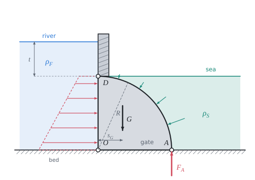

# Force of water on a flat and a curved wall

Theory for the calculation, in our own words. Kalketa checks the formulas in the boxes.



## Hydrostatic pressure

In still liquid the pressure grows linearly with the depth h below the surface; the atmospheric pressure acts on both sides of the wall and cancels:

```kalk
relation p == ρ·g·h
```

On a vertical wall the pressure therefore grows from the surface to the bottom, and the resulting force per metre of width is the area of the pressure diagram. For a wall of length R whose upper edge is at depth t the pressure is ρ·g·(t + s), and the moment about the hinge at the upper edge of the section (arm s) is:

```kalk
R := 1.0 m
ρ := 997 kg/m^3
g := 9.81 m/s^2
t := 2 m
M := integral(ρ·g·(t + s)·s, s: 0 m .. R)
check "The moment of the water on the wall has a closed form": abs(M - ρ·g·(t·R^2/2 + R^3/3)) ≤ 0.001 N·m/m
```

- The term ρ·g·t·R²/2 is the moment of the rectangular part of the pressure (constant pressure ρ·g·t), the term ρ·g·R³/3 the moment of the triangular part.

## Curved wall

Liquid pressure always acts perpendicular to the wall. On a circular arc every elementary increment of the force therefore points to the centre O. The resultant of all these forces also passes through O, so it has the same moment about any point as if it acted at O. We usually split it into a horizontal and a vertical component:

- the horizontal component equals the force on the vertical projection of the arc, that is on a flat vertical wall of height R;
- the vertical component equals the weight of the water above the arc (or of the displaced water below it).

If the centre O lies vertically below the hinge D, the vertical component has no moment about D and only the horizontal component gives a moment, on the arm R:

```kalk
R := 1.0 m
ρ_S := 1025 kg/m^3
g := 9.81 m/s^2
H_S := integral(ρ_S·g·s, s: 0 m .. R)
check "The horizontal component is ρ·g·R²/2": abs(H_S - ρ_S·g·R^2/2) ≤ 0.001 N/m
```

## Moment balance of the gate

The gate turns about the hinge D, so the sum of moments about D is zero as long as there is a contact force F_A in the seal A. The moment of the river opens the gate, the moments of the salt water, of the weight and of the seal close it. The seal acts on the arm R:

```kalk
relation F_A·R == M_S + M_G - M_F
```

The gate opens when F_A drops to zero, that is at M_F = M_S + M_G. Since M_F grows linearly with the river depth t, F_A is also a linear function of t and the opening depth follows from a first-degree equation:

```kalk
relation t_0 == (M_S + M_G - ρ_F·g·R^3/3)/(ρ_F·g·R^2/2)
```

The weight of the gate acts at the centroid of the sector. The source gives the arm of the weight from the vertical wall as R/3.
