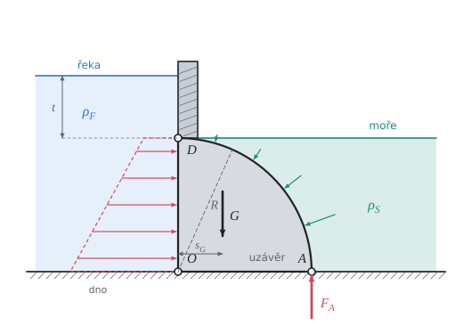

# Síla vody na rovnou a oblou stěnu

Teorie k výpočtu, vlastními slovy. Vzorce v rámečcích Kalketa ověřuje.



## Hydrostatický tlak

V klidné kapalině roste tlak s hloubkou h pod hladinou lineárně, atmosférický tlak působí na obou stranách stěny a vyruší se:

```kalk
relation p == ρ·g·h
```

Na svislou stěnu proto tlak narůstá od hladiny ke dnu a výsledná síla na metr šířky je plocha tlakového obrazce. Pro stěnu délky R, jejíž horní okraj leží v hloubce t, je tlak ρ·g·(t + s) a moment ke kloubu na horním okraji úseku (rameno s):

```kalk
R := 1.0 m
ρ := 997 kg/m^3
g := 9.81 m/s^2
t := 2 m
M := integral(ρ·g·(t + s)·s, s: 0 m .. R)
check "Moment vody na stěnu má uzavřený tvar": abs(M - ρ·g·(t·R^2/2 + R^3/3)) ≤ 0.001 N·m/m
```

- Člen ρ·g·t·R²/2 je moment obdélníkové části tlaku (stálý tlak ρ·g·t), člen ρ·g·R³/3 moment trojúhelníkové části.

## Zakřivená stěna

Tlak kapaliny působí na stěnu vždy kolmo. Na kruhovém oblouku proto každý elementární přírůstek síly míří do středu O. Výslednice všech těchto sil míří také středem O, takže má vůči libovolnému bodu stejný moment jako kdyby působila v O. Obvykle ji rozložíme na vodorovnou a svislou složku:

- vodorovná složka se rovná síle na svislý průmět oblouku, tedy na rovnou svislou stěnu výšky R;
- svislá složka se rovná tíze vody nad obloukem (nebo vytlačené vody pod ním).

Leží-li střed O svisle pod kloubem D, svislá složka k D moment nemá a moment dává jen vodorovná složka na rameni R:

```kalk
R := 1.0 m
ρ_S := 1025 kg/m^3
g := 9.81 m/s^2
H_S := integral(ρ_S·g·s, s: 0 m .. R)
check "Vodorovná složka je ρ·g·R²/2": abs(H_S - ρ_S·g·R^2/2) ≤ 0.001 N/m
```

## Momentová rovnováha uzávěru

Uzávěr se otáčí kolem kloubu D, takže součet momentů k D je nulový, dokud je v těsnění A tlaková síla F_A. Moment řeky otevírá, moment slané vody, tíhy a těsnění zavírá. Těsnění tlačí na rameni R:

```kalk
relation F_A·R == M_S + M_G - M_F
```

Uzávěr se otevře, když F_A klesne na nulu, tedy při M_F = M_S + M_G. Protože M_F roste s hloubkou t řeky lineárně, je i F_A lineární funkcí t a hloubka otevření vychází z rovnice prvního stupně:

```kalk
relation t_0 == (M_S + M_G - ρ_F·g·R^3/3)/(ρ_F·g·R^2/2)
```

Tíha uzávěru působí v těžišti výseče. Zdroj udává rameno tíhy od svislé stěny rovné R/3.
