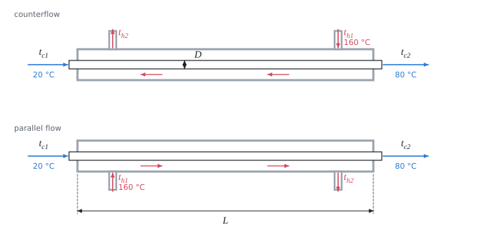

# Heat exchanger: the log mean temperature difference method

The theory behind the calculation, in our own words. Kalketa checks the formulas in the boxes.



## Heat balance

Without losses to the surroundings the hot fluid gives off as much heat as the cold one takes up:

```kalk
relation Q == m_h·c_h·(t_h1 - t_h2)
relation Q == m_c·c_c·(t_c2 - t_c1)
```

From three known temperatures and both mass flow rates the fourth temperature follows.

## Log mean temperature difference

The temperature difference between the fluids changes along the exchanger. The heat flow through the area A is Q = k·A·ΔT_ln, where k is the overall heat transfer coefficient and ΔT_ln the log mean temperature difference from the differences at both ends of the exchanger:

```kalk
relation ΔT_ln == (ΔT_A - ΔT_B)/ln(ΔT_A/ΔT_B)
```

It holds when k and the specific heat capacities do not change along the exchanger and the fluids do not change phase. The logarithmic mean is always smaller than the arithmetic one; for equal differences at the ends they are equal:

```kalk
ΔT_A := 80 K
ΔT_B := 105 K
ΔT_ln := (ΔT_A - ΔT_B)/ln(ΔT_A/ΔT_B)
check "smaller than the arithmetic mean": ΔT_ln < (ΔT_A + ΔT_B)/2
check "larger than the smaller of the differences": ΔT_ln > ΔT_A
```

## Counterflow and parallel flow

- **Counterflow:** the hot fluid enters at the end where the cold one leaves. The temperature difference is more even along the exchanger and its mean value larger. The cold fluid can be heated even above the outlet temperature of the hot one.
- **Parallel flow:** both enter at the same end. At the inlet the difference is large, towards the end it falls quickly, and the cold fluid never exceeds the outlet temperature of the hot one.

For the same temperatures counterflow needs a smaller area, so it is used where possible. Parallel flow is chosen when the wall temperature at the inlet has to be limited (e.g. for sensitive fluids).
