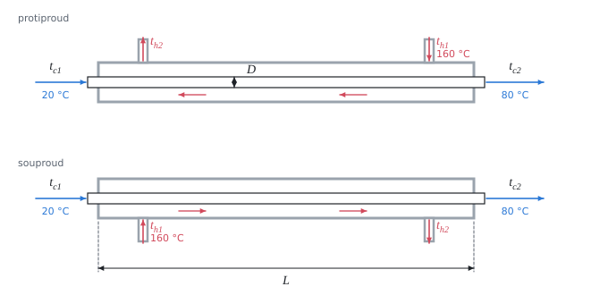

# Výměník tepla: metoda středního logaritmického teplotního rozdílu

Teorie k výpočtu, vlastními slovy. Vzorce v rámečcích Kalketa ověřuje.



## Tepelná bilance

Bez ztrát do okolí odevzdá horká kapalina tolik tepla, kolik přijme studená:

```kalk
relation Q == m_h·c_h·(t_h1 - t_h2)
relation Q == m_c·c_c·(t_c2 - t_c1)
```

Ze tří známých teplot a obou průtoků se tak dopočte čtvrtá teplota.

## Střední logaritmický teplotní rozdíl

Teplotní rozdíl mezi kapalinami se podél výměníku mění. Tepelný tok přes plochu A je Q = k·A·ΔT_ln, kde k je součinitel prostupu tepla a ΔT_ln střední logaritmický teplotní rozdíl z rozdílů na obou koncích výměníku:

```kalk
relation ΔT_ln == (ΔT_A - ΔT_B)/ln(ΔT_A/ΔT_B)
```

Platí, když se k a měrné tepelné kapacity podél výměníku nemění a kapaliny nemění skupenství. Logaritmický průměr je vždy menší než aritmetický; při stejných rozdílech na koncích jsou si rovny:

```kalk
ΔT_A := 80 K
ΔT_B := 105 K
ΔT_ln := (ΔT_A - ΔT_B)/ln(ΔT_A/ΔT_B)
check "menší než aritmetický průměr": ΔT_ln < (ΔT_A + ΔT_B)/2
check "větší než menší z rozdílů": ΔT_ln > ΔT_A
```

## Protiproud a souproud

- **Protiproud:** horká kapalina vstupuje na konci, kde studená odchází. Teplotní rozdíl je podél výměníku vyrovnanější a jeho střední hodnota větší. Studená kapalina se může ohřát i nad výstupní teplotu horké.
- **Souproud:** obě vstupují na stejném konci. Na vstupu je rozdíl velký, ke konci rychle klesá a studená kapalina nikdy nepřekročí výstupní teplotu horké.

Pro stejné teploty potřebuje protiproud menší plochu, proto se používá, kde to jde. Souproud se volí, když je potřeba omezit teplotu stěny na vstupu (např. citlivé látky).

## Kontrola v Pythonu

```python
from math import log, pi
m_c, c_c, m_h, c_h = 1.2, 4189.0, 2.0, 4342.0
Q = m_c * c_c * (80 - 20)
t_h2 = 160 - Q / (m_h * c_h)
for name, t_cA, t_cB in (("counterflow", 80, 20), ("parallel flow", 20, 80)):
    dA, dB = 160 - t_cA, t_h2 - t_cB
    lm = (dA - dB) / log(dA / dB)
    A = Q / (640 * lm)
    print(name, round(lm, 2), "K", round(A, 3), "m2", round(A / (pi * 0.015), 1), "m")
dA, dB = 80, t_h2 - 20
lm = (dA - dB) / log(dA / dB)
result("Q", Q / 1000, "kW")
result("t_h2", t_h2, "°C")
result("ΔT_ln", lm, "K")
result("A", Q / (640 * lm), "m²")
result("L", Q / (640 * lm) / (pi * 0.015), "m")
```
