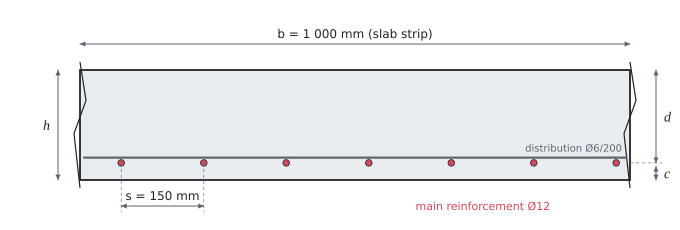

# Bending of a reinforced concrete slab

The theory behind the calculation, in our own words, based on a Czech textbook of CTU and on EN 1992-1-1 (second generation). Kalketa checks the formulas in the boxes as derivations.



## Design strengths

The design compressive strength of concrete follows from the characteristic strength f_ck (30 MPa for C30/37). It is divided by the partial factor γ_C = 1.5 and multiplied by two factors:

```kalk
relation f_cd == η_cc·k_tc·f_ck/γ_C
```

- η_cc = (40 MPa / f_ck)^(1/3), at most 1: stronger concretes are more brittle, so their strength is used to a smaller degree. For f_ck ≤ 40 MPa it comes out as 1.
- k_tc accounts for the age of the concrete at loading. For concrete of strength development class CR with a reference age up to 28 days, which will not be fully loaded sooner than after three months, k_tc = 1; otherwise 0.85 is taken.

The design yield strength of steel is f_yd = f_yk / γ_S, for B500B 500 / 1.15 ≐ 435 MPa. Steel behaves elastically up to yield, so yield is reached at the strain:

```kalk
relation ε_yd == f_yd/E_s
```

## The rectangular stress block

At the ultimate limit state the compressed part of the section has the height x. The real stress distribution in the concrete (a parabola followed by a constant part) is replaced by a rectangle of height 0.8·x with the stress f_cd. The compressive force in the concrete and the tensile force in the reinforcement are in equilibrium:

```kalk
relation F_c == 0.8·x·b·f_cd
relation F_s == A_s·f_yd
relation F_c == F_s
derive x == A_s·f_yd/(0.8·b·f_cd)
```

The resultant of the compression lies at the middle of the rectangle, that is 0.4·x below the top edge. The lever arm of the internal forces z is the distance from it to the centroid of the reinforcement and the resistance is the moment of the pair of forces:

```kalk
relation z == d - 0.4·x
relation M_Rd == F_s·z
relation F_s == A_s·f_yd
derive M_Rd == A_s·f_yd·(d - 0.4·x)
```

The effective depth d is the distance of the centroid of the reinforcement from the compressed edge: the thickness without the cover and half of the bar diameter, d = h − c − Ø/2.

## Reinforcement beyond yield

The equilibrium above assumes that the reinforcement yields (stress f_yd). From the linear distribution of strain over the height of the section (concrete at the edge ε_cu = 3.5 ‰, reinforcement ε_s) it follows that the reinforcement is just at yield when the compression zone reaches the depth:

```kalk
relation ε_cu/x == ε_yd/(d - x)
derive x == ε_cu·d/(ε_cu + ε_yd)
```

The relative height ξ_bal = x/d is about 0.617 for B500B. If the actual x/d is smaller, the reinforcement yields and the design is economical; otherwise the section would fail by crushing of the concrete without warning.

## Three ways to design the reinforcement

From the moment m_Ed per metre of width the area of reinforcement a_s per metre is to be found. All three ways start from the same equilibrium:

1. **Estimate of the lever arm** z ≐ 0.9·d. For slabs the lever arm is really around 0.9 to 0.95·d, so the estimate is on the safe side and is enough for a quick design: a_s = m_Ed / (0.9·d·f_yd).
2. **Moment and dimension coefficients.** The dimensionless moment μ = m_Ed / (b·d²·f_cd) gives from a table (appendix P04, the table Soucinitele_P04) the relative height ξ = x/d and the lever arm ζ = z/d; then a_s = m_Ed / (ζ·d·f_yd).
3. **Direct calculation.** Substituting x from the equilibrium of forces into the moment equation gives a quadratic equation for a_s, whose smaller root is:

```kalk
relation μ == M/(b·d^2·f_cd)
relation ζ == z/d
relation M == A_s·f_yd·z
derive A_s == M/(ζ·d·f_yd)
```

```kalk
b := 1 m
d := 169 mm
f_cd := 20 MPa
f_yd := 435 MPa
M := 40 kN·m
A_s := b·d·f_cd/f_yd·(1 - sqrt(1 - 2·M/(b·d^2·f_cd))) | mm^2
x := A_s·f_yd/(0.8·b·f_cd) | mm
check "The direct formula satisfies equilibrium": abs(M - A_s·f_yd·(d - 0.4·x)) ≤ 1e-9 kN·m
```

The second and third ways give the same result up to the rounding of the table; the first is a little more conservative.

## Detailing rules for slabs

Besides the resistance, the designed reinforcement must satisfy rules that guarantee reasonable behaviour of the slab:

- **Minimum reinforcement:** the resistance must be larger than the moment at which the concrete in tension cracks (m_cr). Otherwise, when the first crack appears, the reinforcement would suddenly take over a force it cannot carry. For a rectangle it is the moment of the elastic section with the stress f_ctm at the edge:

```kalk
relation W == b·h^2/6
relation m_cr == W·f_ctm
derive m_cr == b·h^2·f_ctm/6
```

- **Maximum spacing of bars** in the tension zone is s_slab,max = min(3·h; 400 mm). At the places of the largest moments the stricter min(2·h; 250 mm) from the first generation of the standard is also recommended.
- **Distribution reinforcement** of a one-way slab (in the perpendicular direction) must have at least 20 % of the main reinforcement in the span; it also keeps the largest spacing.

## Assumptions of the calculation

- Rectangular stress block in the compressed concrete, reinforcement with unlimited strain (the horizontal branch of the stress-strain diagram).
- Concrete in tension is not included in the resistance.
- The moment is obtained from a linear elastic analysis; the slab spans in one direction and the calculation is for a strip 1 m wide.
