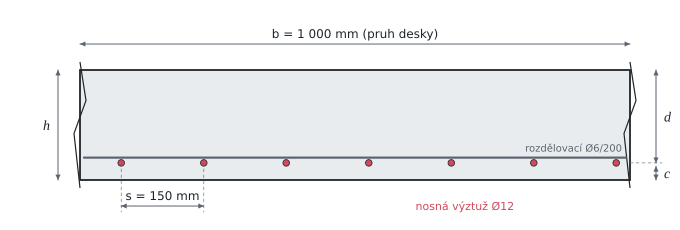

# Ohyb železobetonové desky

Teorie k výpočtu, vlastními slovy podle skript ČVUT a EN 1992-1-1 (druhá generace). Vzorce v rámečcích Kalketa ověřuje jako odvození.



## Návrhové pevnosti

Návrhová pevnost betonu v tlaku vychází z charakteristické pevnosti f_ck (pro C30/37 je 30 MPa). Dělí se dílčím součinitelem γ_C = 1,5 a násobí dvěma součiniteli:

```kalk
relation f_cd == η_cc·k_tc·f_ck/γ_C
```

- η_cc = (40 MPa / f_ck)^(1/3), nejvýš 1: pevnější betony jsou křehčí, proto se jejich pevnost využije menší měrou. Pro f_ck ≤ 40 MPa vychází 1.
- k_tc zohledňuje stáří betonu při zatížení. Pro beton třídy vývoje pevnosti CR s referenčním stářím do 28 dní, který nebude plně zatížen dřív než za tři měsíce, je k_tc = 1; jinak se bere 0,85.

Návrhová mez kluzu oceli je f_yd = f_yk / γ_S, pro B500B 500 / 1,15 ≐ 435 MPa. Ocel se do meze kluzu chová pružně, mez kluzu tedy dosáhne při přetvoření:

```kalk
relation ε_yd == f_yd/E_s
```

## Obdélníkové rozdělení napětí

V mezním stavu únosnosti je tlačená část průřezu vysoká x. Skutečný průběh napětí v betonu (parabola s konstantní částí) se nahrazuje obdélníkem výšky 0,8·x s napětím f_cd. Tlaková síla v betonu a tahová síla ve výztuži jsou v rovnováze:

```kalk
relation F_c == 0.8·x·b·f_cd
relation F_s == A_s·f_yd
relation F_c == F_s
derive x == A_s·f_yd/(0.8·b·f_cd)
```

Výslednice tlaku leží v polovině obdélníku, tedy 0,4·x pod horním okrajem. Rameno vnitřních sil z je vzdálenost od ní k těžišti výztuže a únosnost je moment dvojice sil:

```kalk
relation z == d - 0.4·x
relation M_Rd == F_s·z
relation F_s == A_s·f_yd
derive M_Rd == A_s·f_yd·(d - 0.4·x)
```

Účinná výška d je vzdálenost těžiště výztuže od tlačeného okraje: tloušťka bez krycí vrstvy a poloviny průměru prutu, d = h − c − Ø/2.

## Výztuž za mezí kluzu

Rovnováha výše předpokládá, že výztuž teče (napětí f_yd). Z lineárního průběhu přetvoření po výšce průřezu (beton na okraji ε_cu = 3,5 ‰, výztuž ε_s) plyne, že výztuž je právě na mezi kluzu, když tlačená oblast sahá do hloubky:

```kalk
relation ε_cu/x == ε_yd/(d - x)
derive x == ε_cu·d/(ε_cu + ε_yd)
```

Poměrná výška ξ_bal = x/d je pro B500B asi 0,617. Je-li skutečné x/d menší, výztuž teče a návrh je hospodárný; jinak by průřez porušil drcený beton bez varování.

## Tři způsoby návrhu výztuže

Z momentu m_Ed na metr šířky je potřeba najít plochu výztuže a_s na metr. Všechny tři cesty vycházejí ze stejné rovnováhy:

1. **Odhad ramene** z ≐ 0,9·d. Pro desky bývá rameno skutečně kolem 0,9 až 0,95·d, takže odhad je na bezpečné straně a stačí pro rychlý návrh: a_s = m_Ed / (0,9·d·f_yd).
2. **Momentový a rozměrové součinitele.** Bezrozměrný moment μ = m_Ed / (b·d²·f_cd) určí z tabulky (příloha P04, tabulka Soucinitele_P04) poměrnou výšku ξ = x/d a rameno ζ = z/d; pak a_s = m_Ed / (ζ·d·f_yd).
3. **Přímý výpočet.** Dosazením x z rovnováhy sil do momentové rovnice vznikne kvadratická rovnice pro a_s, jejíž menší kořen je:

```kalk
relation μ == M/(b·d^2·f_cd)
relation ζ == z/d
relation M == A_s·f_yd·z
derive A_s == M/(ζ·d·f_yd)
```

```kalk
b := 1 m
d := 169 mm
f_cd := 20 MPa
f_yd := 435 MPa
M := 40 kN·m
A_s := b·d·f_cd/f_yd·(1 - sqrt(1 - 2·M/(b·d^2·f_cd))) | mm^2
x := A_s·f_yd/(0.8·b·f_cd) | mm
check "Přímý vzorec splňuje rovnováhu": abs(M - A_s·f_yd·(d - 0.4·x)) ≤ 1e-9 kN·m
```

Druhý a třetí způsob dávají totéž až na zaokrouhlení tabulky; první je o něco konzervativnější.

## Konstrukční zásady pro desky

Navržená výztuž musí kromě únosnosti splnit zásady, které zaručí rozumné chování desky:

- **Minimální výztuž:** únosnost musí být větší než moment, při kterém beton v tahu praskne (m_cr). Jinak by při vzniku první trhliny výztuž náhle převzala sílu, kterou neunese. Pro obdélník je to moment pružného průřezu s napětím f_ctm na okraji:

```kalk
relation W == b·h^2/6
relation m_cr == W·f_ctm
derive m_cr == b·h^2·f_ctm/6
```

- **Největší rozteč prutů** v taženém betonu je s_slab,max = min(3·h; 400 mm). V místech největších momentů se doporučuje i přísnější min(2·h; 250 mm) z první generace normy.
- **Rozdělovací výztuž** jednosměrně pnuté desky (v kolmém směru) musí mít aspoň 20 % nosné výztuže v poli; i ona dodržuje největší rozteč.

## Předpoklady výpočtu

- Obdélníkové rozdělení napětí v tlačeném betonu, výztuž s neomezeným přetvořením (vodorovná větev pracovního diagramu).
- Beton v tahu se v únosnosti nezapočítává.
- Moment je spočten lineárně pružnou analýzou; deska je pnutá jedním směrem a počítá se na pruh širokého 1 m.

## Ověření v Pythonu

Jiná cesta k týmž výsledkům: vlastní výpočet bez tabulek (rameno ζ z kvadratické rovnice, ne z přílohy P04) a posudky čistou aritmetikou.

```python
from math import pi, sqrt

h, c, fi = 0.200, 0.025, 0.012
m_Ed = 40e3                       # N·m na metr šířky
f_ck, f_ctm, f_yk = 30e6, 2.9e6, 500e6
E_s, eps_cu = 200e9, 0.0035

f_cd = min((40e6 / f_ck) ** (1 / 3), 1.0) * 1.0 * f_ck / 1.5
f_yd = f_yk / 1.15
d = h - c - fi / 2

a1 = m_Ed / (0.9 * d * f_yd)
mu = m_Ed / (d**2 * f_cd)
xi = (1 - sqrt(1 - 2 * mu)) / 0.8        # x/d z rovnováhy
zeta = 1 - 0.4 * xi
a3 = d * f_cd / f_yd * (1 - sqrt(1 - 2 * mu))
a_prov = pi * fi**2 / 4 / 0.150
x = a_prov * f_yd / (0.8 * f_cd)
m_Rd = a_prov * f_yd * (d - 0.4 * x)
m_cr = h**2 * f_ctm / 6
xi_bal = eps_cu / (eps_cu + f_yd / E_s)

result("f_cd", f_cd / 1e6, "MPa")
result("d", d * 1e3, "mm")
result("a_s_req", a1 * 1e6, "mm^2/m")
result("μ", mu, "")
result("a_s_req_2", m_Ed / (zeta * d * f_yd) * 1e6, "mm^2/m", rel=2e-3)
result("a_s_req_3", a3 * 1e6, "mm^2/m")
result("a_s_prov", a_prov * 1e6, "mm^2/m")
result("x", x * 1e3, "mm")
result("m_Rd", m_Rd / 1e3, "kN·m/m")
result("m_cr", m_cr / 1e3, "kN·m/m")
result("ξ_bal", xi_bal, "")
result("a_s_rv", pi * 0.006**2 / 4 / 0.200 * 1e6, "mm^2/m")
```
