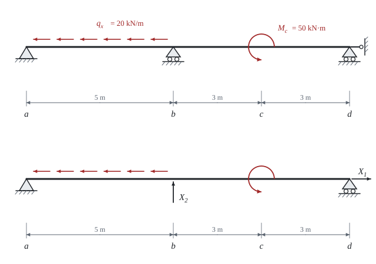

# Force method

Theory for the calculation, in our own words. Kalketa checks the formulas in the boxes.



## The idea

A statically indeterminate beam has more restraints than equilibrium needs. The force method **removes the redundant restraints** and replaces them by unknown forces X_1, X_2, …. What remains is a statically determinate **primary system** that carries the original load and the unknown forces. The unknowns are found from the condition that the beam does not move at the places of the removed restraints, because in reality a restraint is there.

The system is linear, so its effects add up. Three kinds of states are calculated:

- **state 0**: the original load on the primary system, internal forces N_0, M_0,
- **state i**: a unit force in the direction of the unknown X_i on the primary system, internal forces N_i, M_i,
- the result: the sum of state 0 and the states i, each multiplied by its unknown X_i.

## Displacements and canonical equations

The displacement at the place and in the direction of unknown i caused by state k is computed by the Mohr integral of the product of the diagrams. Shear forces are neglected, only bending (M, EI) and the normal force (N, EA) count:

δ_ik = ∫ M_i·M_k/(EI) dx + ∫ N_i·N_k/(EA) dx

The condition of zero total displacement gives the **canonical equations**. For two unknowns:

δ_10 + δ_11·X_1 + δ_12·X_2 = 0, δ_20 + δ_21·X_1 + δ_22·X_2 = 0

By Maxwell's reciprocal theorem δ_ik = δ_ki. In our beam X_1 acts only by the normal force and X_2 only by bending, so δ_12 = δ_21 = 0 and the equations separate into two independent ones:

```kalk
L := 11 m
L_ab := 5 m
q_x := 20 kN/m
δ_11_EA := L
δ_10_EA := q_x·L_ab^2/2
X_1 := -δ_10_EA/δ_11_EA | kN
check "X_1 = −22.727 kN": abs(X_1 + 22.727 kN) ≤ 0.001 kN
```

The formula follows from N_1 = 1 and from N_0 falling linearly from q_x·L_ab at point a to zero at point b: the integral of N_1·N_0 is the area of a triangle, q_x·L_ab^2/2. EA cancels in X_1.

## Integral of a product of diagrams

When one diagram is linear, the integral of the product equals the area of the other diagram times the value of the linear diagram at its centroid (Vereshchagin's rule). For the displacement δ_22, M_2 is a triangle of length L and height h under the force at point b. Its area is L·h/2 and its centroid is at the height 2h/3, so

δ_22·EI = L·h^2/3

```kalk
L_v := 11 m
h := 5 m·6 m/L_v
δ_22_EI := L_v·h^2/3
check "δ_22·EI = 27.27 m³": abs(δ_22_EI - 27.2727 m^3) ≤ 0.001 m^3
```

The integral in the sheet gives the same result. The diagram M_0 has a jump at point c caused by the concentrated moment M_c. For integration the diagram must therefore be split into parts; the sheet does it with `if` in the definition of the function.

## Resulting quantities

Reactions and internal forces are assembled from the states: for example the reaction at support a is A_z = A_z0 + X_2·(L − L_ab)/L, where the second term is the reaction due to the unit force at b, multiplied by the unknown. The reactions are checked by two equilibrium equations, the sum of vertical forces and the sum of moments about point a. They hold for any value of X_2, so they reveal an error in assembling the states but not an error in X_2 itself; that is found by comparison with an independent calculation (the Check in Python layer).
