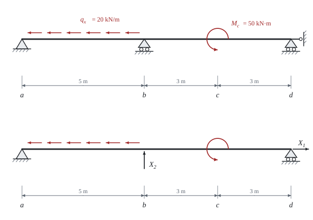

# Silová metoda

Teorie k výpočtu, vlastními slovy. Vzorce v rámečcích Kalketa ověřuje.



## Myšlenka

Staticky neurčitý nosník má víc vazeb, než kolik jich rovnováha potřebuje. Silová metoda **odebere přebytečné vazby** a nahradí je neznámými silami X_1, X_2, …. Zbyde staticky určitá **základní soustava**, na kterou působí původní zatížení a neznámé síly. Neznámé se najdou z podmínky, že v místech odebraných vazeb se nosník nepřemístí, protože tam ve skutečnosti vazba je.

Soustava je lineární, a proto se její účinky sčítají. Počítají se tři druhy stavů:

- **stav 0**: původní zatížení na základní soustavě, vnitřní síly N_0, M_0,
- **stav i**: jednotková síla ve směru neznámé X_i na základní soustavě, vnitřní síly N_i, M_i,
- výsledek: součet stavu 0 a stavů i, každého násobeného neznámou X_i.

## Přemístění a kanonické rovnice

Přemístění v místě a směru neznámé i vyvolané stavem k se počítá Mohrovým integrálem součinu obrazců. Posouvající síly se zanedbávají, jen ohyb (M, EI) a normálová síla (N, EA):

δ_ik = ∫ M_i·M_k/(EI) dx + ∫ N_i·N_k/(EA) dx

Podmínka nulového celkového přemístění dává **kanonické rovnice**. Pro dvě neznámé:

δ_10 + δ_11·X_1 + δ_12·X_2 = 0, δ_20 + δ_21·X_1 + δ_22·X_2 = 0

Podle Maxwellovy věty o vzájemnosti je δ_ik = δ_ki. V našem nosníku působí X_1 jen normálovou silou a X_2 jen ohybem, proto δ_12 = δ_21 = 0 a rovnice se rozpadnou na dvě samostatné:

```kalk
L := 11 m
L_ab := 5 m
q_x := 20 kN/m
δ_11_EA := L
δ_10_EA := q_x·L_ab^2/2
X_1 := -δ_10_EA/δ_11_EA | kN
check "X_1 = −22,727 kN": abs(X_1 + 22.727 kN) ≤ 0.001 kN
```

Vzorec vyplývá z toho, že N_1 = 1 a N_0 klesá lineárně od q_x·L_ab v bodě a do nuly v bodě b: integrál N_1·N_0 je plocha trojúhelníku q_x·L_ab^2/2. EA se v X_1 zkrátí.

## Integrál součinu obrazců

Když je jeden obrazec lineární, rovná se integrál součinu ploše druhého obrazce krát hodnota lineárního obrazce v jeho těžišti (Vereščaginovo pravidlo). Pro přemístění δ_22 je M_2 trojúhelník o délce L a výšce h pod silou v bodě b. Plocha je L·h/2, těžiště je ve výšce 2h/3, tedy

δ_22·EI = L·h^2/3

```kalk
L_v := 11 m
h := 5 m·6 m/L_v
δ_22_EI := L_v·h^2/3
check "δ_22·EI = 27,27 m³": abs(δ_22_EI - 27.2727 m^3) ≤ 0.001 m^3
```

Tentýž výsledek dává integrál přesně v listu. Obrazec M_0 má v bodě c skok, který způsobuje osamělý moment M_c. Při integraci se proto musí obrazec rozdělit na úseky; list to dělá pomocí `if` v zápisu funkce.

## Výsledné veličiny

Reakce a vnitřní síly se složí ze stavů: například reakce v podpoře a je A_z = A_z0 + X_2·(L − L_ab)/L, kde druhý člen je reakce od jednotkové síly v b, násobená neznámou. Výpočet reakcí se ověří dvěma rovnicemi rovnováhy, součtem svislých sil a součtem momentů k bodu a. Platí pro libovolnou hodnotu X_2, takže odhalí chybu ve skládání stavů, ale ne chybu v samotném X_2; ta se najde porovnáním s nezávislým výpočtem (vrstva Kontrola v Pythonu).
