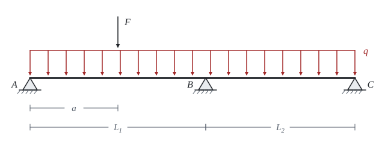

# Continuous beam

The theory behind the calculation, in our own words. Kalketa verifies the formulas in the boxes.



## Why equilibrium is not enough

A beam on three supports has three vertical reactions, but equilibrium in the plane gives only two equations for vertical forces and moments. The beam is statically indeterminate to the first degree: the missing equation comes from the condition that the deflection curve is continuous over the middle support, with no kink.

## The three-moment equation

Clapeyron's equation connects the moments over three consecutive supports. It follows from equal rotations of both spans over the middle support, when the beam is imagined cut over the supports and the unknown moments are added at the cuts. For a constant section and zero moments at the ends one unknown remains:

2·M_B·(L_1 + L_2) = −(q·L_1³/4 + q·L_2³/4 + F·a·(L_1² − a²)/L_1)

The term with F holds for a force in the left span at the distance a from the end support. Without the force F it gives:

```kalk
L_1 := 6 m
L_2 := 4.5 m
q := 12 kN/m
M_B := -(q·L_1^3/4 + q·L_2^3/4)/(2·(L_1 + L_2)) | kN·m
check "M_B = −43.875 kN·m without the force F": abs(M_B + 43.875 kN·m) ≤ 0.001 kN·m
```

A negative moment means tension at the top. That is why the top flange is checked over the support of a continuous beam, and why concrete needs reinforcement there.

## What the function beam calculates

`beam` uses the stiffness method: the unknowns are the rotations and displacements at the nodes and each span is described by the exact relations of a bar. The result is therefore exact between the nodes too, without a mesh and without rounding from a division into elements. Unlike the formulas in the sheet, its procedure cannot be checked by eye, so it makes sense to compare its result with another calculation. Here that is the three-moment equation in the sheet and the integration of the curvature in the Check in Python layer.

## Deflection

The curvature is proportional to the moment, EI·w″ = −M. Two integrations and the conditions of zero deflection at the supports give the deflection of each span. The largest deflection is in the longer span and is smaller than in a simple beam of the same span, because the moment over the support holds the span back.
