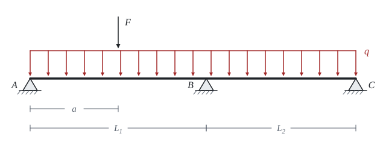

# Spojitý nosník

Teorie k výpočtu, vlastními slovy. Vzorce v rámečcích Kalketa ověřuje.



## Proč rovnováha nestačí

Nosník na třech podporách má tři svislé reakce, rovnováha v rovině ale dává jen dvě rovnice pro svislé síly a momenty. Nosník je jednou staticky neurčitý: chybějící rovnici dodá podmínka, že ohybová čára je nad střední podporou spojitá a nemá zlom.

## Rovnice tří momentů

Clapeyronova rovnice spojí momenty nad třemi po sobě jdoucími podporami. Odvodí se z rovnosti pootočení obou polí nad střední podporou, když se nosník v myšlenkách nad podporami rozřízne a do řezů se doplní neznámé momenty. Pro stálý průřez a nulové momenty na krajích zbude jediná neznámá:

2·M_B·(L_1 + L_2) = −(q·L_1³/4 + q·L_2³/4 + F·a·(L_1² − a²)/L_1)

Člen se silou F platí pro sílu v levém poli ve vzdálenosti a od krajní podpory. Bez síly F vychází:

```kalk
L_1 := 6 m
L_2 := 4.5 m
q := 12 kN/m
M_B := -(q·L_1^3/4 + q·L_2^3/4)/(2·(L_1 + L_2)) | kN·m
check "M_B = −43,875 kN·m bez síly F": abs(M_B + 43.875 kN·m) ≤ 0.001 kN·m
```

Záporný moment znamená tah nahoře. Proto se u spojitého nosníku nad podporou kontroluje horní pásnice a v betonu tam patří výztuž.

## Co počítá funkce beam

`beam` používá deformační metodu: neznámé jsou pootočení a posuny v uzlech a každé pole se popíše přesnými vztahy pro prut. Výsledek je proto přesný i mezi uzly, bez sítě a bez zaokrouhlení z dělení na prvky. Na rozdíl od vzorců v listu se ale postup nedá ověřit očima, a tak má smysl jeho výsledek porovnat s jiným výpočtem. Tady to dělá rovnice tří momentů v listu a integrace křivosti ve vrstvě Kontrola v Pythonu.

## Průhyb

Křivost je úměrná momentu, EI·w″ = −M. Dvě integrace a podmínky nulového průhybu na podporách dají průhyb každého pole. Největší průhyb je v delším poli a je menší než u prostého nosníku téhož rozpětí, protože moment nad podporou pole přidržuje.
