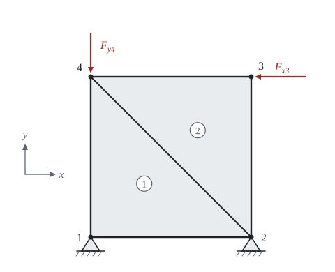

# A wall of triangular elements

The theory behind the calculation, in our own words. Kalketa checks the formulas in the boxes.



## The idea of the method

We divide the wall into elements joined at nodes. The unknowns are the displacements of the nodes, two at each node: u in the direction x and v in the direction y. Inside an element the displacement is prescribed by a simple function of the nodal displacements; from it the strain is computed, from the strain the stress, and from the stress the forces at the nodes. The equilibrium of forces at every node then gives the system of equations K·r = F.

## An element with three nodes

The displacement inside a triangle is a linear function of the coordinates, u = α₁ + α₂·x + α₃·y and the same for v. The constants are determined from the six nodal displacements. The strains are derivatives of the displacement, so they are **constant** in the whole element; that is why it is called a constant-strain element. For nodes i, j, k counterclockwise with the area A we have ε = B·u_e, where

b_i = y_j − y_k, c_i = x_k − x_j (and cyclically for j and k),

B = 1/(2·A)·[b_i 0 b_j 0 b_k 0 | 0 c_i 0 c_j 0 c_k | c_i b_i c_j b_j c_k b_k].

A test on a right triangle with nodes (0; 0), (1; 0), (0; 1) m: when the displacement equals the coordinate (u = x μm/m, that is u = 0, 1, 0 μm at the nodes and v = 0), we must get ε_x = 10⁻⁶ and the other two strains zero:

```kalk
B := [-1, 0, 1, 0, 0, 0 | 0, -1, 0, 0, 0, 1 | -1, -1, 0, 1, 1, 0]/(1 m)
u_p := [0 μm | 0 μm | 1 μm | 0 μm | 0 μm | 0 μm]
ε := B·u_p
check "The linear displacement u = x gives ε_x = 1·10⁻⁶": abs(ε[1] - 0.000001) ≤ 1e-15
check "and zero ε_y and γ_xy": abs(ε[2]) + abs(ε[3]) ≤ 1e-15
```

## Stiffness matrix of the element

From the strain energy, because both B and D are constant in the element, we get

k = t·A·Bᵀ·D·B.

The matrix is symmetric and a simple test holds for it: when the element is moved as a rigid body, no force arises. The sum of the entries of a row in the columns u (and separately in v) must therefore be zero. This test can find an error in a matrix written out by hand: a single entry with a wrong sign is enough to change the displacements of the wall.

```kalk
B := [-1, 0, 1, 0, 0, 0 | 0, -1, 0, 0, 0, 1 | -1, -1, 0, 1, 1, 0]/(1 m)
E := 20 GPa
ν := 0.2
t := 0.1 m
A := 0.5 m^2
D := E/(1 - ν^2)·[1, ν, 0 | ν, 1, 0 | 0, 0, (1 - ν)/2]
k := t·A·transpose(B)·D·B | MN/m
p_x := [1 | 0 | 1 | 0 | 1 | 0] m
check "Moving the whole element horizontally causes no force": norm(k·p_x) ≤ 0.001 N
check "The multiplier t·E/(2·(1 − ν²)) is 1041.7 MN/m": abs(t·E/(2·(1 - ν^2)) - 1041.667 MN/m) ≤ 0.001 MN/m
```

## Assembly into the matrix of the whole structure

Every displacement of an element has its number in the whole structure. An entry of the element matrix that belongs to the row number a and the column number b is added at the place [a, b] of the matrix of the whole; where several elements meet at a node, the entries are summed. A fixed degree of freedom gets the number 0 and its row is left out, because its displacement is known (zero) and no equation is needed for it. The smallest example: two equal springs in a row, the first one fixed.

```kalk
k_s := [1, -1 | -1, 1]·100 kN/m
K := sum(scatter(k_s, [e - 1, e], 2), e: 1 .. 2)
check "The middle node carries both springs: K[1,1] = 2·k": abs(K[1, 1] - 200 kN/m) ≤ 0.001 kN/m
check "The end node only one: K[2,2] = k": abs(K[2, 2] - 100 kN/m) ≤ 0.001 kN/m
```

## Reactions and stresses

After the system is solved, the remaining rows of the matrix of the whole (those of the fixed nodes) are multiplied by the vector of all displacements and give the reactions. The reactions and the load must be in equilibrium of forces and of moments; this is the best check of the whole assembly. The stress in an element is σ = D·B·u_e. It is constant, and therefore jumps at the boundary of the elements; the finer the division, the smaller the jumps.
