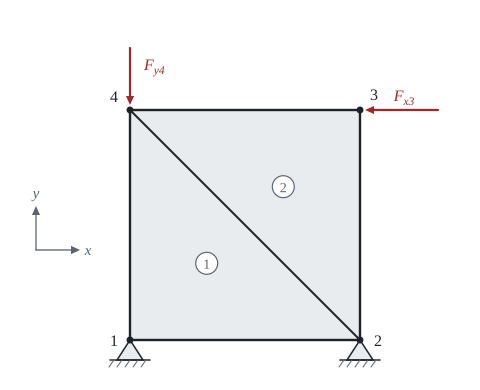

# Stěna z trojúhelníkových prvků

Teorie k výpočtu, vlastními slovy. Vzorce v rámečcích Kalketa ověřuje.



## Myšlenka metody

Stěnu rozdělíme na prvky spojené v uzlech. Neznámé jsou posunutí uzlů, u každého uzlu dvě: u ve směru x a v ve směru y. Uvnitř prvku se posunutí předepíše jednoduchou funkcí uzlových posunutí, z ní se spočítá deformace, z deformace napětí a z napětí síly v uzlech. Rovnováha sil v každém uzlu pak dá soustavu rovnic K·r = F.

## Prvek se třemi uzly

Posunutí uvnitř trojúhelníka je lineární funkce souřadnic, u = α₁ + α₂·x + α₃·y a stejně v. Konstanty se určí ze šesti uzlových posunutí. Deformace jsou derivace posunutí, takže jsou v celém prvku **konstantní**; proto se prvek jmenuje prvek s konstantní deformací. Pro uzly i, j, k proti směru hodinových ručiček s plochou A platí ε = B·u_e, kde

b_i = y_j − y_k, c_i = x_k − x_j (a cyklicky dál pro j a k),

B = 1/(2·A)·[b_i 0 b_j 0 b_k 0 | 0 c_i 0 c_j 0 c_k | c_i b_i c_j b_j c_k b_k].

Zkouška na pravoúhlém trojúhelníku s uzly (0; 0), (1; 0), (0; 1) m: když se posunutí rovná souřadnici (u = x μm/m, tedy u = 0, 1, 0 μm v uzlech a v = 0), musí vyjít ε_x = 10⁻⁶ a obě ostatní deformace nula:

```kalk
B := [-1, 0, 1, 0, 0, 0 | 0, -1, 0, 0, 0, 1 | -1, -1, 0, 1, 1, 0]/(1 m)
u_p := [0 μm | 0 μm | 1 μm | 0 μm | 0 μm | 0 μm]
ε := B·u_p
check "Lineární posunutí u = x dává ε_x = 1·10⁻⁶": abs(ε[1] - 0.000001) ≤ 1e-15
check "a nulové ε_y a γ_xy": abs(ε[2]) + abs(ε[3]) ≤ 1e-15
```

## Matice tuhosti prvku

Z energie deformace, protože B i D jsou v prvku konstantní, vychází

k = t·A·Bᵀ·D·B.

Matice je symetrická a platí pro ni jednoduchá zkouška: když se prvek posune jako tuhý celek, nevznikne žádná síla. Součet členů řádku v sloupcích u (a zvlášť v) proto musí být nula. Podle ní se dá najít chyba v ručně vypsané matici: jediný chybný znaménkem člen stačí, aby posunutí stěny vyšlo jinak.

```kalk
B := [-1, 0, 1, 0, 0, 0 | 0, -1, 0, 0, 0, 1 | -1, -1, 0, 1, 1, 0]/(1 m)
E := 20 GPa
ν := 0.2
t := 0.1 m
A := 0.5 m^2
D := E/(1 - ν^2)·[1, ν, 0 | ν, 1, 0 | 0, 0, (1 - ν)/2]
k := t·A·transpose(B)·D·B | MN/m
p_x := [1 | 0 | 1 | 0 | 1 | 0] m
check "Posunutí celého prvku vodorovně nevyvolá sílu": norm(k·p_x) ≤ 0.001 N
check "Násobitel t·E/(2·(1 − ν²)) je 1 041,7 MN/m": abs(t·E/(2·(1 - ν^2)) - 1041.667 MN/m) ≤ 0.001 MN/m
```

## Sestavení do matice celku

Každé posunutí prvku má své číslo v celé konstrukci. Člen matice prvku, který patří řádku s číslem a sloupci s číslem b, se přičte na místo [a, b] matice celku; kde se setká více prvků v jednom uzlu, členy se sečtou. Podepřený stupeň volnosti dostane číslo 0 a jeho řádek se vynechá, protože jeho posunutí je známé (nula) a rovnice pro něj není potřeba. Nejmenší příklad: dvě stejné pružiny za sebou, první je upevněná.

```kalk
k_s := [1, -1 | -1, 1]·100 kN/m
K := sum(scatter(k_s, [e - 1, e], 2), e: 1 .. 2)
check "Střední uzel nese obě pružiny: K[1,1] = 2·k": abs(K[1, 1] - 200 kN/m) ≤ 0.001 kN/m
check "Koncový uzel jen jednu: K[2,2] = k": abs(K[2, 2] - 100 kN/m) ≤ 0.001 kN/m
```

## Reakce a napětí

Po vyřešení soustavy se zbylé řádky matice celku (podepřených uzlů) vynásobí vektorem všech posunutí a dají reakce. Součet reakcí a zatížení musí být v rovnováze sil i momentů; to je nejlepší kontrola celé sestavy. Napětí v prvku je σ = D·B·u_e. Je konstantní, a proto na hranici prvků skáče; čím jemnější dělení, tím menší skoky.
