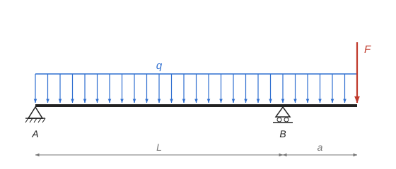

# Bending of a beam with an overhang {#T1}

The theory behind the calculation, in our own words. Kalketa checks the formulas in the boxes.



## Reactions from the equilibrium conditions {#T2}

A beam on two supports is statically determinate: the reactions follow from two equilibrium conditions. The sum of vertical forces is zero and the sum of moments about any point is zero. It pays to write the moment condition about one of the supports, because then only the reaction of the other support remains in it. For the reactions we replace the uniform load by its resultant q·(L + a), which acts at the middle of the loaded length.

```kalk
L := 5 m
a := 1.5 m
q := 8 kN/m
F := 12 kN
relation R_A + R_B == q·(L + a) + F
relation R_B·L == q·(L + a)^2/2 + F·(L + a)
R_B := (q·(L + a)^2/2 + F·(L + a))/L | kN
R_A := q·(L + a) + F - R_B | kN
check "Sum of forces": abs(R_A + R_B - q·(L + a) - F) ≤ 0.001 kN
check "Moment about support B": abs(R_A·L - (q·L^2/2 - q·a^2/2 - F·a)) ≤ 0.001 kN·m
```

## Shear force and bending moment {#T3}

The bending moment at the section x is the sum of the moments of all forces on one side of the section. In the span between the supports it is calculated from the left; on the overhang it is simpler to calculate from the free end on the right. The shear force is the derivative of the moment, V = dM/dx, so the moment has an extreme where V is zero.

```kalk
L := 5 m
a := 1.5 m
q := 8 kN/m
R_A := 14.6 kN
F := 12 kN
relation M(x) == R_A·x - q·x^2/2
relation x_0 == R_A/q
relation M_B == -(q·a^2/2 + F·a)
M_pole(x) := R_A·x - q·x^2/2 | kN·m
x_0 := R_A/q | m
M_B := -(q·a^2/2 + F·a) | kN·m
check "Moment at B from the span and from the overhang": abs(M_pole(L) - M_B) ≤ 0.001 kN·m
check "The extreme is at V = 0": abs(derivative(M_pole(x), x: x_0)) ≤ 0.001 kN
```

- A positive moment puts the bottom fibres in tension, a negative one the top fibres.
- Over support B the moment is negative; the overhang bends the beam hogging.
- The shear force jumps at a support by its reaction; the moment does not jump.

## Stress in bending {#T4}

The normal stress in bending varies linearly over the height of the section. It is zero at the neutral axis, which passes through the centroid, and largest at the edges of the section. For a rectangle of width b and height h the section modulus is W = I/(h/2) = b·h²/6:

```kalk
b := 140 mm
h := 300 mm
M := 27 kN·m
relation W == b·h^2/6
relation σ_max == abs(M)/W
W := b·h^2/6 | cm³
σ_max := abs(M)/W | MPa
check "W = 2100 cm³": abs(W - 2100 cm^3) ≤ 0.001 cm^3
```

The check compares the largest stress with the design bending strength of the material. The moment with the largest absolute value governs, whether it is positive or negative.
