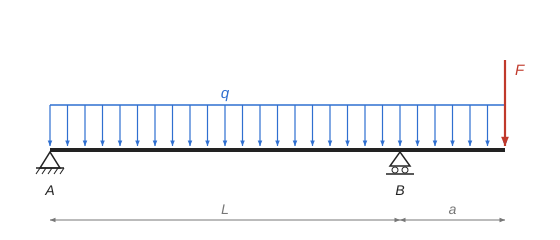

# Ohyb nosníku s převislým koncem {#T1}

Teorie k výpočtu, vlastními slovy. Vzorce v rámečcích Kalketa ověřuje.



## Reakce z podmínek rovnováhy {#T2}

Nosník na dvou podporách je staticky určitý: reakce plynou ze dvou podmínek rovnováhy. Součet svislých sil je nulový a součet momentů k libovolnému bodu je nulový. Je výhodné psát momentovou podmínku k jedné z podpor, pak v ní zůstane jen reakce druhé podpory. Spojité zatížení nahradíme při výpočtu reakcí jeho výslednicí q·(L + a), která působí v polovině zatížené délky.

```kalk
L := 5 m
a := 1.5 m
q := 8 kN/m
F := 12 kN
relation R_A + R_B == q·(L + a) + F
relation R_B·L == q·(L + a)^2/2 + F·(L + a)
R_B := (q·(L + a)^2/2 + F·(L + a))/L | kN
R_A := q·(L + a) + F - R_B | kN
check "Součet sil": abs(R_A + R_B - q·(L + a) - F) ≤ 0.001 kN
check "Moment k podpoře B": abs(R_A·L - (q·L^2/2 - q·a^2/2 - F·a)) ≤ 0.001 kN·m
```

## Posouvající síla a ohybový moment {#T3}

Ohybový moment v průřezu x je součet momentů všech sil po jedné straně řezu. V poli mezi podporami se moment počítá zleva, na převislém konci je jednodušší počítat zprava od volného konce. Posouvající síla je derivace momentu, V = dM/dx, proto má moment extrém tam, kde je V nulová.

```kalk
L := 5 m
a := 1.5 m
q := 8 kN/m
R_A := 14.6 kN
F := 12 kN
relation M(x) == R_A·x - q·x^2/2
relation x_0 == R_A/q
relation M_B == -(q·a^2/2 + F·a)
M_pole(x) := R_A·x - q·x^2/2 | kN·m
x_0 := R_A/q | m
M_B := -(q·a^2/2 + F·a) | kN·m
check "Moment v B z pole a z převisu": abs(M_pole(L) - M_B) ≤ 0.001 kN·m
check "Extrém je při V = 0": abs(derivative(M_pole(x), x: x_0)) ≤ 0.001 kN
```

- Kladný moment táhne spodní vlákna, záporný horní.
- Nad podporou B je moment záporný, převislý konec ohýbá nosník nahoru vypouklý.
- Posouvající síla skokem naroste v podpoře o její reakci, moment se nemění skokem.

## Napětí za ohybu {#T4}

Normálové napětí při ohybu se po výšce průřezu mění lineárně. Na neutrální ose, která prochází těžištěm, je nulové, největší je na okrajích průřezu. Pro obdélník šířky b a výšky h je průřezový modul W = I/(h/2) = b·h²/6:

```kalk
b := 140 mm
h := 300 mm
M := 27 kN·m
relation W == b·h^2/6
relation σ_max == abs(M)/W
W := b·h^2/6 | cm³
σ_max := abs(M)/W | MPa
check "W = 2100 cm³": abs(W - 2100 cm^3) ≤ 0.001 cm^3
```

Posudek porovnává největší napětí s návrhovou pevností materiálu v ohybu. Rozhoduje moment s největší absolutní hodnotou, ať je kladný, nebo záporný.
