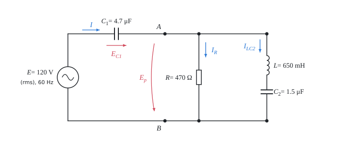

# An AC circuit in complex form

The theory behind the calculation, in our own words. Kalketa checks the formulas in the boxes.



## Impedance and phasors

With a harmonic alternating current of angular frequency ω, the voltage and the current are described by complex numbers (phasors) and the relation between them is Ohm's law with a complex impedance Z. A resistor has a real impedance, an inductor a positive imaginary one and a capacitor a negative imaginary one; so the current through an inductor lags the voltage by 90° and a capacitor leads it by 90°:

```kalk
relation Z_R == R
relation Z_L == 1j·ω·L
relation Z_C == 1/(1j·ω·C)
```

A quarter turn is the same as multiplying by j, so 1/j = −j:

```kalk
j2 := 1j·1j
check "j squared is minus one": abs(j2 + 1) ≤ 1e-12
```

## Connecting elements

Elements in series share the current and their impedances add. Elements in parallel share the voltage and their reciprocals (admittances) add:

```kalk
relation Z_s == Z_1 + Z_2
relation 1/Z_p == 1/Z_1 + 1/Z_2
```

For two branches the parallel connection can also be written as the product over the sum. This holds only for two branches:

```kalk
Z_1 := 470 Ω
Z_2 := 1j·200 Ω
Z_p := 1/(1/Z_1 + 1/Z_2) | Ω
check "product over sum": abs(Z_p - Z_1·Z_2/(Z_1 + Z_2)) ≤ 1e-9 Ω
```

## Kirchhoff's laws and power

At every node the phasors of currents add up to zero, and in every loop so do the phasors of voltages. In a calculation they serve as a check: if the phasors did not add up, there is a mistake in some step. The complex power is the voltage times the complex conjugate of the current. Its real part is the active power, which turns into heat; the imaginary part is the reactive power of inductors and capacitors, which is only exchanged with the source:

```kalk
relation S == E·conj(I)
relation P == re(S)
```

In a circuit without losses in inductors and capacitors, all the active power is produced in the resistors. For example, a current of 100 mA through a resistor of 470 Ω gives a power of

```kalk
I_0 := 100 mA
R_0 := 470 Ω
P_0 := I_0^2·R_0 | W
check "4.7 W": abs(P_0 - 4.7 W) ≤ 1e-9 W
```
