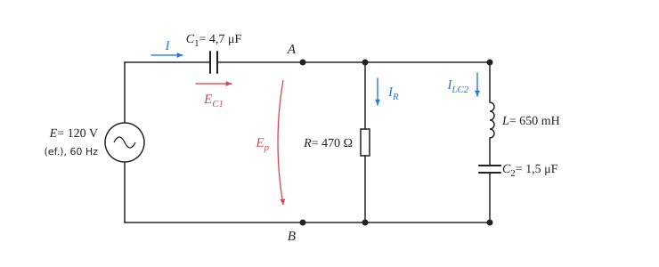

# Střídavý obvod v komplexním tvaru

Teorie k výpočtu, vlastními slovy. Vzorce v rámečcích Kalketa ověřuje.



## Impedance a fázory

Při harmonickém střídavém proudu úhlové frekvence ω se napětí a proud popíšou komplexními čísly (fázory) a vztah mezi nimi je Ohmův zákon s komplexní impedancí Z. Rezistor má impedanci reálnou, cívka kladnou imaginární a kondenzátor zápornou imaginární; proud cívkou se proto za napětím zpožďuje o 90° a kondenzátorem napětí o 90° předbíhá:

```kalk
relation Z_R == R
relation Z_L == 1j·ω·L
relation Z_C == 1/(1j·ω·C)
```

Čtvrtinová otáčka je totéž co násobení číslem j, proto je 1/j = −j:

```kalk
j2 := 1j·1j
check "j na druhou je minus jedna": abs(j2 + 1) ≤ 1e-12
```

## Řazení prvků

Sériové prvky mají společný proud a jejich impedance se sčítají. Paralelní prvky mají společné napětí a sčítají se jejich převrácené hodnoty (admitance):

```kalk
relation Z_s == Z_1 + Z_2
relation 1/Z_p == 1/Z_1 + 1/Z_2
```

Pro dvě větve se dá paralelní spojení napsat i jako součin lomený součtem. Platí to jen pro dvě větve:

```kalk
Z_1 := 470 Ω
Z_2 := 1j·200 Ω
Z_p := 1/(1/Z_1 + 1/Z_2) | Ω
check "součin lomený součtem": abs(Z_p - Z_1·Z_2/(Z_1 + Z_2)) ≤ 1e-9 Ω
```

## Kirchhoffovy zákony a výkon

V každém uzlu se fázory proudů sčítají na nulu a ve smyčce fázory napětí také. Ve výpočtu proto slouží jako posudek: kdyby se fázory nesčítaly, je v nějakém kroku chyba. Komplexní výkon je napětí krát komplexně sdružený proud. Jeho reálná část je činný výkon, který se mění v teplo, imaginární část je jalový výkon cívek a kondenzátorů, který se jen vyměňuje se zdrojem:

```kalk
relation S == E·conj(I)
relation P == re(S)
```

V obvodu bez ztrát v cívkách a kondenzátorech vzniká všechen činný výkon v rezistorech. Pro příklad: proud 100 mA rezistorem 470 Ω dá výkon

```kalk
I_0 := 100 mA
R_0 := 470 Ω
P_0 := I_0^2·R_0 | W
check "4,7 W": abs(P_0 - 4.7 W) ≤ 1e-9 W
```
