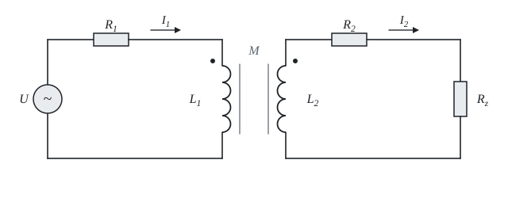

# Magnetically coupled coils

The theory behind the calculation, in our own words. Kalketa verifies the formulas in the boxes.



## Mutual inductance

The current in one coil creates a magnetic flux, part of which also passes through the other coil and induces a voltage in it. This voltage is proportional to the change of the current and the constant of proportionality is the mutual inductance M. In a steady sinusoidal state the derivative turns into a factor jω, so the induced voltage is jω·M·I.

The coupling factor k = M/√(L_1·L_2) tells what part of the flux is shared. It cannot be larger than 1, or the coils would produce energy. That is why the sheet has a check on it.

## Mesh equations

For the primary and the secondary, by the dots in the picture:

Z_1·I_1 − jω·M·I_2 = U, −jω·M·I_1 + Z_2·I_2 = 0

The sign of the term with M depends on how the windings are wound. Reversing the secondary turns the phase of I_2 by 180°, but changes neither the size of the currents nor the power, because M is squared in the reflected impedance.

## Reflected impedance

From the second equation I_2 = jω·M·I_1/Z_2. Putting it into the first gives Z_v = Z_1 + (ω·M)²/Z_2. The load on the secondary thus appears in the primary as an added impedance. Its imaginary part has the opposite sign to Z_2, so an inductive secondary appears capacitive in the primary and reduces its effective inductance:

```kalk
ω := 314.16 rad/s
M := 15 mH
Z_2 := (7 + 3.1416j) Ω
Z_o := (ω·M)^2/Z_2
check "The reflected impedance is proportional to the complex conjugate of Z_2": abs(Z_o - (ω·M)^2·conj(Z_2)/abs(Z_2)^2) ≤ 0.000001 Ω
```

## Efficiency

Losses arise in the resistances of the windings. The efficiency is the ratio of the power in the load to the active power of the source and does not depend on the source voltage, because the system is linear. It does depend on the load: a small load resistance gives large currents and large losses, a large one transfers little power. The chart in the sheet shows the power by the resistance.
