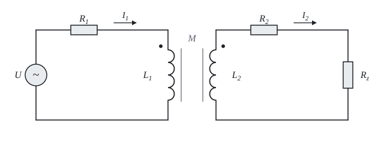

# Magneticky vázané cívky

Teorie k výpočtu, vlastními slovy. Vzorce v rámečcích Kalketa ověřuje.



## Vzájemná indukčnost

Proud v jedné cívce vytváří magnetický tok, jehož část prochází i druhou cívkou a indukuje v ní napětí. Toto napětí je úměrné změně proudu a konstantou úměrnosti je vzájemná indukčnost M. V ustáleném sinusovém stavu se derivace změní na násobek jω, takže indukované napětí je jω·M·I.

Činitel vazby k = M/√(L_1·L_2) říká, jaká část toku je společná. Nemůže být větší než 1, jinak by cívky vyráběly energii. Proto je v listu posudek.

## Rovnice smyček

Pro primár a sekundár podle teček na obrázku platí:

Z_1·I_1 − jω·M·I_2 = U, −jω·M·I_1 + Z_2·I_2 = 0

Znaménko členu s M závisí na tom, jak jsou vinutí navinutá. Změna smyslu sekundáru otočí fázi I_2 o 180°, ale velikost proudů ani výkon nezmění, protože v odražené impedanci je M na druhou.

## Odražená impedance

Ze druhé rovnice je I_2 = jω·M·I_1/Z_2. Po dosazení do první vyjde Z_v = Z_1 + (ω·M)²/Z_2. Zátěž na sekundáru se tedy na primáru projeví jako přidaná impedance. Její imaginární část má opačné znaménko než Z_2, takže indukční sekundár se do primáru promítne kapacitně a účinnou indukčnost primáru zmenší:

```kalk
ω := 314.16 rad/s
M := 15 mH
Z_2 := (7 + 3.1416j) Ω
Z_o := (ω·M)^2/Z_2
check "Odražená impedance je úměrná komplexně sdružené Z_2": abs(Z_o - (ω·M)^2·conj(Z_2)/abs(Z_2)^2) ≤ 0.000001 Ω
```

## Účinnost

Ztráty vznikají v odporech vinutí. Účinnost je podíl výkonu v zátěži a činného výkonu zdroje a nezávisí na napětí zdroje, protože je soustava lineární. Závisí ale na zátěži: malý odpor zátěže dává velké proudy a velké ztráty, velký odpor přenese málo výkonu. Graf v listu ukazuje průběh výkonu podle odporu.
