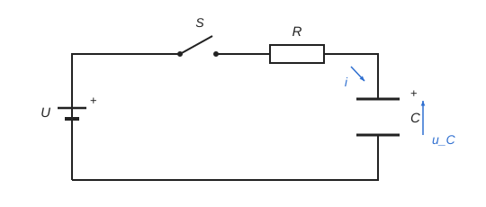

# Transient in an RC circuit {#T1}

The theory for the calculation, in our own words. Kalketa checks the formulas in the boxes.



## Circuit equations {#T2}

After the switch is closed the source voltage divides between the resistor and the capacitor. The current charges the capacitor, so it is proportional to the rate at which its voltage rises. Substituting the current into the voltage equation gives a single first-order differential equation for the capacitor voltage; the product R·C stands at the derivative and sets the speed of the process.

```kalk
relation U == R·i + u_C
relation i == C·du_C/dt
derive R·C·du_C/dt + u_C == U
```

## Solution: exponential charging {#T3}

The solution is an exponential with the time constant τ = R·C. A discharged capacitor has zero voltage at the start, so the current is largest at the start, limited only by the resistor. The sum of the voltages across the resistor and the capacitor equals the source voltage at every instant.

```kalk
relation τ == R·C
relation u_C(t) == U·(1 - exp(-t/τ))
relation i(t) == U/R·exp(-t/τ)
```

- After one time constant the capacitor voltage reaches the fraction 1 − e⁻¹ of its final value; after five time constants the process is practically over (e⁻⁵ of the final value remains).
- The time to charge to a fraction k of the source voltage follows by inverting the exponential: t = −τ·ln(1 − k). It depends on the component values only through τ.

Substituting numbers checks that both forms give the same fraction at t = τ and that the voltages add up to U:

```kalk
τ := 4.7 kΩ·220 μF | s
q := 1 - exp(-1)
check "The voltage at time τ is 1 − e⁻¹ of the final value": abs(12 V·(1 - exp(-τ/τ)) - 12 V·q) ≤ 1e-12 V
check "The voltages across R and C add up to the source voltage": abs(12 V/(4.7 kΩ)·exp(-1 s/τ)·4.7 kΩ + 12 V·(1 - exp(-1 s/τ)) - 12 V) ≤ 1e-9 V
```

## Energy of the capacitor {#T4}

A charged capacitor stores energy in its electric field. During charging the source delivers the charge C·U at the voltage U, so the energy C·U², but exactly half of it is stored in the capacitor. The other half turns into heat in the resistor, independently of its resistance, because the integral of R·i² over the whole charging gives C·U²/2 for any R.

```kalk
relation W == C·U^2/2
```
