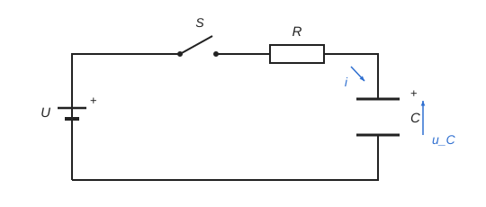

# Přechodový děj v obvodu RC {#T1}

Teorie k výpočtu, vlastními slovy. Vzorce v rámečcích Kalketa ověřuje.



## Rovnice obvodu {#T2}

Po sepnutí spínače se napětí zdroje rozdělí mezi rezistor a kondenzátor. Proud nabíjí kondenzátor, a proto je úměrný rychlosti, s jakou roste jeho napětí. Dosazením proudu do napěťové rovnice vznikne jediná diferenciální rovnice prvního řádu pro napětí na kondenzátoru; součin R·C stojí u derivace a určuje rychlost děje.

```kalk
relation U == R·i + u_C
relation i == C·du_C/dt
derive R·C·du_C/dt + u_C == U
```

## Řešení: exponenciální nabíjení {#T3}

Řešením je exponenciála s časovou konstantou τ = R·C. Vybitý kondenzátor má na začátku nulové napětí, a proud je proto na začátku největší, omezený jen rezistorem. Součet napětí na rezistoru a na kondenzátoru je v každém okamžiku roven napětí zdroje.

```kalk
relation τ == R·C
relation u_C(t) == U·(1 - exp(-t/τ))
relation i(t) == U/R·exp(-t/τ)
```

- Za jednu časovou konstantu dosáhne napětí na kondenzátoru podílu 1 − e⁻¹ konečné hodnoty, za pět časových konstant je děj prakticky ukončený (zbývá e⁻⁵ konečné hodnoty).
- Dobu nabití na podíl k napětí zdroje dostaneme obrácením exponenciály: t = −τ·ln(1 − k). Nezávisí na hodnotách součástek jinak než přes τ.

Dosazením čísel se ověří, že obě formulace dají v čase t = τ týž podíl a že součet napětí je U:

```kalk
τ := 4.7 kΩ·220 μF | s
q := 1 - exp(-1)
check "Napětí v čase τ je 1 − e⁻¹ konečné hodnoty": abs(12 V·(1 - exp(-τ/τ)) - 12 V·q) ≤ 1e-12 V
check "Součet napětí na R a C je napětí zdroje": abs(12 V/(4.7 kΩ)·exp(-1 s/τ)·4.7 kΩ + 12 V·(1 - exp(-1 s/τ)) - 12 V) ≤ 1e-9 V
```

## Energie kondenzátoru {#T4}

Nabitý kondenzátor uchovává energii v elektrickém poli. Zdroj dodá při nabití náboj C·U při napětí U, tedy energii C·U², ale do kondenzátoru se z ní uloží právě polovina. Druhá polovina se změní na teplo v rezistoru, nezávisle na jeho odporu, protože integrál z R·i² přes celé nabíjení dá C·U²/2 pro jakékoli R.

```kalk
relation W == C·U^2/2
```
