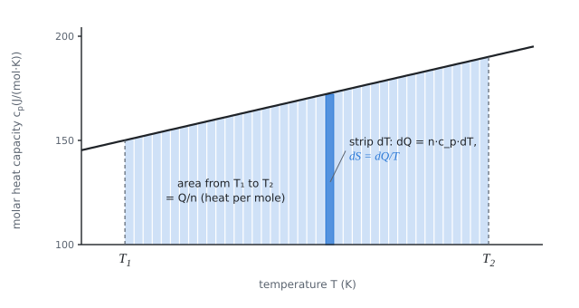

# Entropy on heating

The theory behind the calculation, in our own words. Kalketa checks the formulas in the boxes.



## Entropy and reversible heat

Entropy is a state function whose change in a reversible process is the heat received divided by the temperature at which it was received:

```kalk
relation dS == dQ/T
```

At constant pressure the heat received by a substance of amount n equals n·c_p·dT, where c_p is the molar heat capacity. Substituting gives a relation that is integrated from the initial temperature T₁ to the final temperature T₂:

```kalk
relation dQ == n·c_p·dT
```

## Heat capacity as a polynomial

For solids, c_p is described over a wide temperature range by an expression a + b·T + c/T². Here the numbers are such that the third term is negligible. The integral of c_p/T can be done term by term:

- a/T integrates to a·ln(T₂/T₁),
- b integrates to b·(T₂ − T₁),
- c/T³ integrates to −c/2·(1/T₂² − 1/T₁²).

A check on a small example with constant heat capacity, where the result is known: heating 1 mol of a substance with c_p = 30 J/(mol·K) from 300 K to 600 K increases the entropy by c_p·ln 2.

```kalk
c_k := 30 J/(mol·K)
n_k := 1 mol
ΔS_k := n_k·c_k·ln(600/300) | J/K
check "Constant c_p: ΔS = n·c_p·ln 2": abs(ΔS_k - 20.794415 J/K) ≤ 0.001 J/K
```

## Mean temperature of heating

The heat supplied Q and the entropy change ΔS define the mean thermodynamic temperature T_s = Q/ΔS. For constant c_p it is the logarithmic mean of the limits, always smaller than the arithmetic one:

```kalk
T_1 := 300 K
T_2 := 600 K
T_s := (T_2 - T_1)/ln(T_2/T_1) | K
check "T_s is smaller than the arithmetic mean 450 K": T_s < 450 K
```

The reason: at a lower temperature the same heat increases the entropy more, so lower temperatures count for more in the average.
