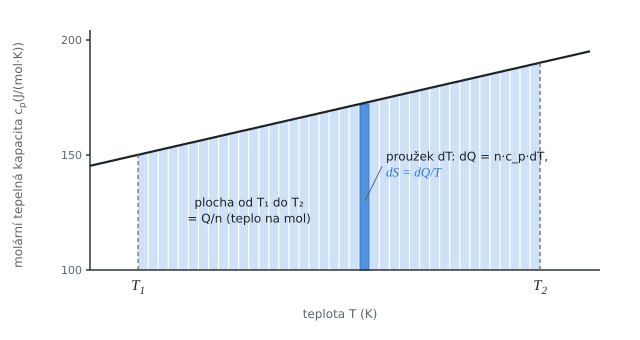

# Entropie při ohřevu

Teorie k výpočtu, vlastními slovy. Vzorce v rámečcích Kalketa ověřuje.



## Entropie a vratné teplo

Entropie je stavová veličina, jejíž změna při vratném ději je dána podílem přijatého tepla a teploty, při které se přijalo:

```kalk
relation dS == dQ/T
```

Při stálém tlaku je teplo přijaté látkou o látkovém množství n rovné n·c_p·dT, kde c_p je molární tepelná kapacita. Dosazením vznikne vztah, který se integruje od počáteční teploty T₁ po koncovou T₂:

```kalk
relation dQ == n·c_p·dT
```

## Tepelná kapacita jako polynom

U pevných látek se c_p v širokém rozsahu teplot popisuje výrazem a + b·T + c/T². Zde jsou čísla taková, že třetí člen je zanedbatelný. Integrál c_p/T se dá spočítat po členech:

- a/T se integruje na a·ln(T₂/T₁),
- b se integruje na b·(T₂ − T₁),
- c/T³ se integruje na −c/2·(1/T₂² − 1/T₁²).

Ověření malým příkladem s konstantní tepelnou kapacitou, kde výsledek známe: ohřev 1 mol látky s c_p = 30 J/(mol·K) z 300 K na 600 K zvětší entropii o c_p·ln 2.

```kalk
c_k := 30 J/(mol·K)
n_k := 1 mol
ΔS_k := n_k·c_k·ln(600/300) | J/K
check "Konstantní c_p: ΔS = n·c_p·ln 2": abs(ΔS_k - 20.794415 J/K) ≤ 0.001 J/K
```

## Střední teplota ohřevu

Dodané teplo Q a změna entropie ΔS určují střední termodynamickou teplotu T_s = Q/ΔS. Pro konstantní c_p je to logaritmický průměr mezí, vždy menší než aritmetický:

```kalk
T_1 := 300 K
T_2 := 600 K
T_s := (T_2 - T_1)/ln(T_2/T_1) | K
check "T_s je menší než aritmetický průměr 450 K": T_s < 450 K
```

Příčina: při nižší teplotě stejné teplo zvětší entropii víc, proto se nižší teploty v průměru uplatní silněji.
