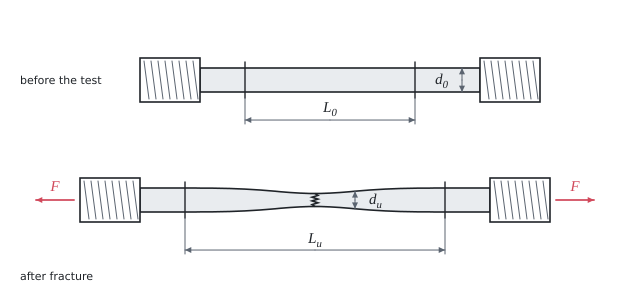

# Tensile test

Theory for the calculation, in our own words. Kalketa verifies the formulas in the boxes.



## Engineering stress

In a tensile test (EN ISO 6892-1) the bar is stretched and the force and the extension are recorded. The stress is related to the **original** cross-section S₀ even though the bar narrows. It is the conventional (engineering) stress:

```kalk
relation R == F/S_0
```

- **Offset yield strength R_p0.2**: the stress at which the permanent deformation reaches 0.2 %. For steels without a marked yield point it replaces the yield strength R_e.
- **Tensile strength R_m**: the greatest force divided by S₀. Beyond it the deformation concentrates in the neck and the force falls, even though the true stress in the neck keeps growing.

The true stress at fracture is related to the cross-section of the neck and is therefore much greater than R_m (here 794 MPa against 331 MPa).

## Elongation and reduction of area

Elongation is the permanent extension of the gauge length after fracture, reduction of area is the decrease of the cross-section at the fracture:

```kalk
relation A == (L_u - L_0)/L_0
relation Z == (S_0 - S_u)/S_0
```

The extension consists of a uniform part (along the whole length) and a local part in the neck. The local part is almost the same for any gauge length, so the elongation from a longer gauge length comes out smaller. That is why proportional bars with L₀ = 5.65·√S₀ are used (elongation A₅.₆₅, formerly A₅ = five diameters):

```kalk
d_0 := 10 mm
S_0 := π·d_0^2/4
L_0 := 5.65·sqrt(S_0) | mm
check "L_0 is about five diameters": abs(L_0 - 5·d_0) ≤ 0.1 mm
```

## Energy

**Resilience** is the energy of elastic deformation per unit volume, the area under the straight line of the tensile diagram up to the yield strength: U_r = R_e²/(2·E). **Tensile toughness** is the area under the whole diagram up to fracture; without a record of the diagram it is estimated as the mean of the yield strength and the tensile strength times the elongation. The unit MPa = MJ/m³.

**The strain hardening ratio** R_m/R_p0.2 says how much the material hardens by plastic deformation. Structural steels have 1.3 to 1.6, high-strength steels closer to 1.
