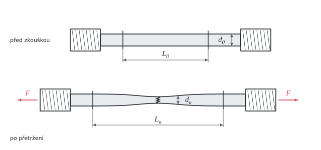

# Zkouška tahem

Teorie k výpočtu, vlastními slovy. Vzorce v rámečcích Kalketa ověřuje.



## Smluvní napětí

Při zkoušce tahem (ČSN EN ISO 6892-1) se tyč natahuje a zapisuje se síla a prodloužení. Napětí se vztahuje k **původnímu** průřezu S₀, i když se tyč zužuje. Je to smluvní (inženýrské) napětí:

```kalk
relation R == F/S_0
```

- **Smluvní mez kluzu R_p0,2**: napětí, při kterém trvalá deformace dosáhne 0,2 %. U ocelí bez výrazné meze kluzu nahrazuje mez kluzu R_e.
- **Mez pevnosti R_m**: největší síla dělená S₀. Za ní se deformace soustředí do krčku a síla klesá, i když skutečné napětí v krčku roste dál.

Skutečné napětí při lomu se vztahuje k průřezu krčku a je proto mnohem větší než R_m (zde 794 MPa proti 331 MPa).

## Tažnost a zúžení

Tažnost je trvalé prodloužení měrné délky po lomu, zúžení je zmenšení průřezu v místě lomu:

```kalk
relation A == (L_u - L_0)/L_0
relation Z == (S_0 - S_u)/S_0
```

Prodloužení se skládá z rovnoměrné části (po celé délce) a z místní části v krčku. Místní část je skoro stejná pro každou měrnou délku, takže tažnost z delší měrné délky vychází menší. Proto se používají poměrné tyče s L₀ = 5,65·√S₀ (tažnost A₅,₆₅, dříve A₅ = pět průměrů):

```kalk
d_0 := 10 mm
S_0 := π·d_0^2/4
L_0 := 5.65·sqrt(S_0) | mm
check "L_0 je asi pět průměrů": abs(L_0 - 5·d_0) ≤ 0.1 mm
```

## Energie

**Resilience** je energie pružné deformace v jednotce objemu, plocha pod přímkou tahového diagramu do meze kluzu: U_r = R_e²/(2·E). **Tahová houževnatost** je plocha pod celým diagramem až do lomu; bez záznamu diagramu se odhadne jako průměr meze kluzu a pevnosti krát tažnost. Jednotka MPa = MJ/m³.

**Míra deformačního zpevnění** R_m/R_p0,2 říká, o kolik materiál zpevní plastickou deformací. Konstrukční oceli mají 1,3 až 1,6, vysokopevné oceli blíž k 1.

## Kontrola v Pythonu

```python
from math import pi, sqrt
d0, F02, Fm, Fu, du, E = 9.95, 17.21e3, 25.75e3, 17.39e3, 5.28, 210e3
S0 = pi * d0**2 / 4
Su = pi * du**2 / 4
Rp, Rm = F02 / S0, Fm / S0
A565 = (68.5 - 50) / 50
result("S_0", S0, "mm²")
result("R_p02", Rp, "MPa")
result("R_m", Rm, "MPa")
result("Z", (S0 - Su) / S0 * 100, "%")
result("A_565", A565 * 100, "%")
result("A_100", (128 - 100) / 100 * 100, "%")
result("σ_u", Fu / Su, "MPa")
result("U_r", Rp**2 / (2 * E), "MJ/m³")
result("U_t", (Rp + Rm) / 2 * A565, "MJ/m³")
result("n_z", Rm / Rp, "")
```
