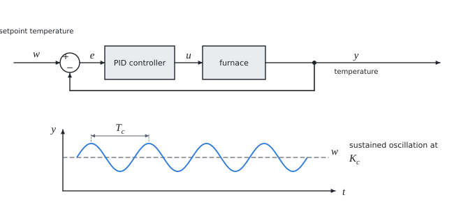

# Controller tuning by the critical gain method

Theory for the calculation, in our own words. Kalketa verifies the formulas in the boxes.



## PID controller

The controller calculates the control action u from the control error e = w − y (setpoint minus actual value) with three parts:

- **proportional** K_p·e reacts to the size of the error,
- **integral** K_i·∫e dt removes the permanent error that would remain with a pure P controller,
- **derivative** K_d·de/dt reacts to the rate of change and damps the oscillation.

In the form with time constants K_i = K_p/T_i and K_d = K_p·T_d.

## The critical gain method

Ziegler and Nichols (1942) proposed to tune the controller by the behaviour of the loop at the limit of stability, without a mathematical model of the plant:

1. The controller is set as purely proportional.
2. The gain is raised until the controlled quantity oscillates with constant amplitude. This is the critical gain K_c; the period of the oscillation T_c is measured.
3. The controller constants are calculated from K_c and T_c according to the table.

The classical Ziegler–Nichols table for PID is K_p = 0.6·K_c, T_i = T_c/2, T_d = T_c/8:

```kalk
K_c := 0.43
T_c := 5.25 s
K_p := 0.6·K_c
T_i := T_c/2
T_d := T_c/8
K_i := K_p/T_i | s^-1
K_d := K_p·T_d | s
check "integral constant from the time form": abs(K_i - 1.2·K_c/T_c) ≤ 0.0001 s^-1
check "derivative constant from the time form": abs(K_d - 0.075·K_c·T_c) ≤ 0.0001 s
```

The table of the source has for PID a slightly smaller proportional gain (0.59 instead of 0.6) and with it the integral multiple 1.18 and the derivative 0.075. The derivative multiple is thus the same as in the classical table.

Ziegler–Nichols tuning is rather "aggressive": the step response has an overshoot of about 25 % and the response damps one period to a quarter. For calmer control the gain is reduced further (for example the rules of Tyreus and Luyben).
