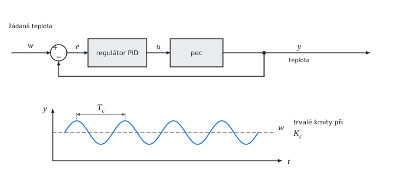

# Nastavení regulátoru metodou kritického zesílení

Teorie k výpočtu, vlastními slovy. Vzorce v rámečcích Kalketa ověřuje.



## Regulátor PID

Regulátor počítá akční zásah u z regulační odchylky e = w − y (žádaná minus skutečná hodnota) třemi složkami:

- **proporcionální** K_p·e reaguje na velikost odchylky,
- **integrační** K_i·∫e dt odstraní trvalou odchylku, která by s čistým P regulátorem zůstala,
- **derivační** K_d·de/dt reaguje na rychlost změny a tlumí kmitání.

Ve tvaru s časovými konstantami je K_i = K_p/T_i a K_d = K_p·T_d.

## Metoda kritického zesílení

Ziegler a Nichols (1942) navrhli nastavit regulátor podle chování smyčky na mezi stability, bez matematického modelu soustavy:

1. Regulátor se nastaví jako čistě proporcionální.
2. Zesílení se zvyšuje, dokud regulovaná veličina nekmitá se stálou amplitudou. To je kritické zesílení K_c; změří se perioda kmitů T_c.
3. Konstanty regulátoru se vypočtou z K_c a T_c podle tabulky.

Klasická tabulka Zieglera a Nicholse pro PID je K_p = 0,6·K_c, T_i = T_c/2, T_d = T_c/8:

```kalk
K_c := 0.43
T_c := 5.25 s
K_p := 0.6·K_c
T_i := T_c/2
T_d := T_c/8
K_i := K_p/T_i | s^-1
K_d := K_p·T_d | s
check "integrační konstanta z časového tvaru": abs(K_i - 1.2·K_c/T_c) ≤ 0.0001 s^-1
check "derivační konstanta z časového tvaru": abs(K_d - 0.075·K_c·T_c) ≤ 0.0001 s
```

Tabulka zdroje má pro PID trochu menší proporcionální zesílení (0,59 místo 0,6) a k němu integrační násobek 1,18 a derivační 0,075. Derivační násobek je tedy stejný jako v klasické tabulce.

Nastavení podle Zieglera a Nicholse je dost „ostré“: přechodový děj má překmit kolem 25 % a odezva tlumí jednu periodu na čtvrtinu. Pro klidnější regulaci se zesílení dál zmenšuje (např. pravidla Tyreuse a Luybena).
