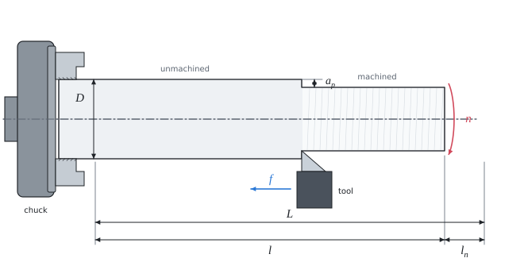

# Cutting conditions and machining time in turning

Theory for the calculation, in our own words. Kalketa verifies the formulas in the boxes.



## Cutting speed and spindle speed

The cutting speed v_c is the peripheral speed of the workpiece at the point of cut. It is chosen according to the material of the tool and of the workpiece (machinability tables); the spindle speed is calculated from it:

```kalk
relation v_c == π·D·n
```

Cemented carbide withstands a much higher temperature at the point of cut than high-speed steel, so it machines about three times faster.

## Machining time

In one revolution the tool advances by the feed f. The tool path L is the length of the machined surface plus the approach (and possibly the overrun):

```kalk
relation t_m == L/(n·f)
```

For example for 1000 min⁻¹, a feed of 0.2 mm and a path of 100 mm:

```kalk
n := 1000 min^-1
f := 0.2 mm
L := 100 mm
t_m := L/(n·f) | s
check "half a minute": abs(t_m - 30 s) ≤ 0.001 s
```

## Tool life and tool consumption

The tool life T is the cutting time after which the edge becomes so blunt that it must be resharpened or replaced. In that time T/t_m parts are machined. A cemented carbide insert has more usable cutting edges (here four), it is indexed when blunt, and only after all the edges is it replaced.

The tool life falls steeply with the cutting speed (Taylor's relation v_c·T^m = const.). A higher speed thus shortens the machining time but uses up more edges. The cutting conditions in the tables therefore seek a compromise between machine costs and tool costs.
