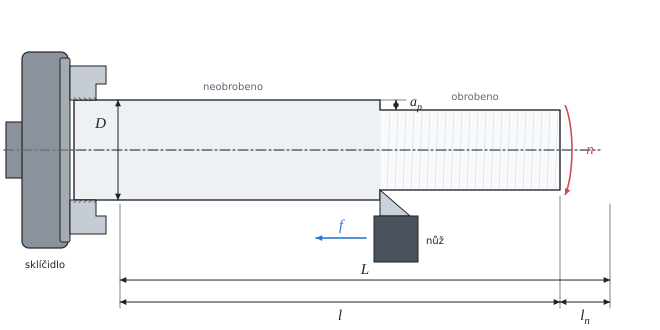

# Řezné podmínky a strojní čas při soustružení

Teorie k výpočtu, vlastními slovy. Vzorce v rámečcích Kalketa ověřuje.



## Řezná rychlost a otáčky

Řezná rychlost v_c je obvodová rychlost obrobku v místě řezu. Volí se podle materiálu nástroje a obrobku (tabulky obrobitelnosti); otáčky vřetena se z ní dopočtou:

```kalk
relation v_c == π·D·n
```

Slinutý karbid snese mnohem vyšší teplotu v místě řezu než rychlořezná ocel, proto se s ním obrábí asi třikrát rychleji.

## Strojní čas

Nůž ujede za jednu otáčku posuv f. Dráha nástroje L je délka obráběné plochy a nájezd (případně i přeběh):

```kalk
relation t_m == L/(n·f)
```

Například pro 1000 min⁻¹, posuv 0,2 mm a dráhu 100 mm:

```kalk
n := 1000 min^-1
f := 0.2 mm
L := 100 mm
t_m := L/(n·f) | s
check "půl minuty": abs(t_m - 30 s) ≤ 0.001 s
```

## Trvanlivost a spotřeba nástrojů

Trvanlivost T je čas řezání, po kterém se ostří otupí natolik, že se musí přeostřit nebo vyměnit. Za tu dobu se obrobí T/t_m součástí. Destička ze slinutého karbidu má víc využitelných hran (zde čtyři), po otupení se otočí, a teprve po všech hranách se vymění.

Trvanlivost silně klesá s řeznou rychlostí (Taylorův vztah v_c·T^m = konst.). Vyšší rychlost tedy zkrátí strojní čas, ale spotřebuje víc ostří. Řezné podmínky v tabulkách proto hledají kompromis mezi náklady na stroj a na nástroje.
