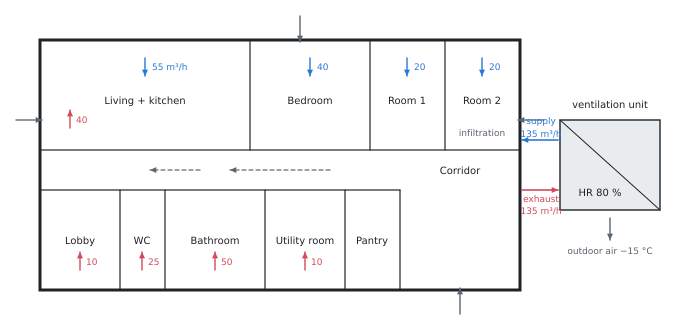

# Ventilation heat loss according to ČSN EN 12831-1

Theory for the calculation, in our own words. Kalketa verifies the formulas in the boxes as derivations.



## What makes up the ventilation loss

The outdoor air that gets into a room has to be heated to the indoor temperature. The power needed for that is the ventilation heat loss. The standard ČSN EN 12831-1 (2018) builds it from three parts:

- **through the building envelope:** infiltration through leaks, ventilation grilles, open openings; but at least as much as the minimum necessary ventilation,
- **by forced ventilation:** air supplied by the unit, if the unit does not heat it to the room temperature,
- **by air transfer:** air flowing over from a colder neighbouring room (a bathroom at 24 °C draws from rooms at 20 °C).

Each part is an air flow times the volumetric heat capacity of air times a temperature difference:

```kalk
relation Q == V·ρ·c·(t_i - t_x)
```

For air around 20 °C, ρ·c = 1.2 kg/m³ · 0.28 W·h/(kg·K):

```kalk
ρc := 1.2 kg/m^3·0.28 W·h/(kg·K)
check "ρ·c of air is about 0.34 W·h/(m³·K)": abs(ρc - 0.336 W·h/(m^3·K)) ≤ 0.001 W·h/(m^3·K)
```

## Simplified and universal procedure

The **simplified procedure** holds for very airtight buildings without forced ventilation: the loss is calculated only from the minimum flow n_min·V (for living rooms n_min = 0.5 h⁻¹).

The **universal procedure** is used as soon as the building has forced ventilation or is not airtight enough. The infiltration is derived from the airtightness of the envelope: from the air change rate at a pressure difference of 50 Pa (n₅₀, the Blower Door test) the specific air permeability of the envelope is determined, and from it the flow by additional infiltration into the whole building. This is divided among the rooms according to the area of their envelope; the orientation factor f_dir = 2 takes into account that the wind pushes air in only through one side of the house.

The loss through the envelope of a room is the higher of two flows: the one actually infiltrated, and the one missing to the minimum ventilation after subtracting the air supplied by force. When the unit supplies more than the minimum (as in the living room, 55 > 48.6 m³/h), only the infiltration remains.

## Heat recovery

The heat recovery (HR) exchanger passes part of the heat of the extracted air to the supplied air. Its temperature factor η says what part of the temperature difference it makes up:

```kalk
relation t_rec == t_e + η·(t_i - t_e)
derive (t_rec - t_e)/(t_i - t_e) == η
```

A unit without reheating supplies air at the temperature t_rec; the rest up to t_i must be supplied by a radiator in the room. The loss by forced ventilation is therefore only (1 − η) of that without recovery:

```kalk
relation t_rec == t_e + η·(t_i - t_e)
relation Q_s == V·ρc·(t_i - t_rec)
derive Q_s == (1 - η)·V·ρc·(t_i - t_e)
```

With an efficiency of 80 % it is a fifth: in the example 318 W instead of roughly 1590 W.

If the unit reheats the air to t_i with a heater, this part is not counted in the loss of the room. It does belong to the balance of the heat source, though, because the heater is connected to the same source.

## Airtightness

The result is most affected by the chosen airtightness. The standard gives a specific air permeability of the envelope of 2 to 12 m³/(h·m²) depending on whether an airtightness test is made; without a test it would come out 6 to 12, which is four to nine times the value used in the example. ČSN 73 0540-2 recommends n₅₀ = 1.5 h⁻¹ for buildings with forced ventilation and 1.0 h⁻¹ with recovery; from n₅₀ the specific air permeability is calculated as n₅₀·V/A_env.
