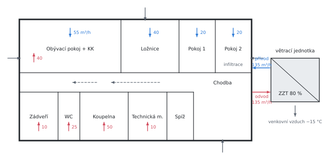

# Tepelná ztráta větráním podle ČSN EN 12831-1

Teorie k výpočtu, vlastními slovy. Vzorce v rámečcích Kalketa ověřuje jako odvození.



## Co ztrátu větráním tvoří

Venkovní vzduch, který se do místnosti dostane, je třeba ohřát na vnitřní teplotu. Výkon k tomu potřebný je tepelná ztráta větráním. Norma ČSN EN 12831-1 (2018) ji skládá ze tří částí:

- **obálkou budovy:** infiltrace netěsnostmi, větrací mřížky, otevřené otvory; nejméně však tolik, kolik je minimální potřebné větrání,
- **nuceným větráním:** vzduch přiváděný jednotkou, pokud ho jednotka nedohřeje na teplotu místnosti,
- **převodem vzduchu:** vzduch přetékající z chladnější sousední místnosti (koupelna 24 °C nasává z místností s 20 °C).

Každá část je průtok vzduchu krát objemová tepelná kapacita vzduchu krát rozdíl teplot:

```kalk
relation Q == V·ρ·c·(t_i - t_x)
```

Pro vzduch kolem 20 °C je ρ·c = 1,2 kg/m³ · 0,28 W·h/(kg·K):

```kalk
ρc := 1.2 kg/m^3·0.28 W·h/(kg·K)
check "ρ·c vzduchu je asi 0,34 W·h/(m³·K)": abs(ρc - 0.336 W·h/(m^3·K)) ≤ 0.001 W·h/(m^3·K)
```

## Zjednodušený a univerzální postup

**Zjednodušený postup** platí pro velmi těsné budovy bez nuceného větrání: ztráta se počítá jen z minimálního průtoku n_min·V (pro obytné místnosti n_min = 0,5 h⁻¹).

**Univerzální postup** se použije, jakmile je v budově nucené větrání nebo budova není dost těsná. Infiltrace se odvodí ze vzduchotěsnosti obálky: z intenzity výměny vzduchu při tlakovém rozdílu 50 Pa (n₅₀, zkouška Blower Door) se stanoví měrná průvzdušnost obálky a z ní průtok dodatečnou infiltrací do celé budovy. Ten se rozdělí na místnosti podle plochy jejich obálky; součinitel orientace f_dir = 2 bere v úvahu, že vítr tlačí vzduch dovnitř jen jednou stranou domu.

Ztráta obálkou místnosti je vyšší ze dvou průtoků: skutečně infiltrovaného, a toho, co chybí do minimálního větrání po odečtení vzduchu dodaného nuceně. Když jednotka přivádí víc než minimum (jako v obývacím pokoji, 55 > 48,6 m³/h), zůstane jen infiltrace.

## Rekuperace

Výměník zpětného získávání tepla (ZZT) předá přiváděnému vzduchu část tepla odváděného vzduchu. Jeho teplotní faktor η říká, jakou část rozdílu teplot dožene:

```kalk
relation t_rec == t_e + η·(t_i - t_e)
derive (t_rec - t_e)/(t_i - t_e) == η
```

Jednotka bez dohřevu přivádí vzduch o teplotě t_rec; zbytek do t_i musí dodat otopné těleso v místnosti. Ztráta nuceným větráním je proto jen (1 − η) z té bez rekuperace:

```kalk
relation t_rec == t_e + η·(t_i - t_e)
relation Q_s == V·ρc·(t_i - t_rec)
derive Q_s == (1 - η)·V·ρc·(t_i - t_e)
```

S účinností 80 % je to pětina: v příkladu 318 W místo zhruba 1 590 W.

Pokud jednotka vzduch dohřívá na t_i ohřívačem, do ztráty místnosti se tato část nepočítá. Patří ale do bilance zdroje tepla, protože ohřívač je napojený na stejný zdroj.

## Vzduchotěsnost

Výsledek nejvíc ovlivní zvolená vzduchotěsnost. Norma uvádí měrnou průvzdušnost obálky 2 až 12 m³/(h·m²) podle toho, zda se zkouška těsnosti provede; bez zkoušky by vyšlo 6 až 12, tedy čtyř- až devítinásobek hodnoty použité v příkladu. ČSN 73 0540-2 doporučuje n₅₀ = 1,5 h⁻¹ pro budovy s nuceným větráním a 1,0 h⁻¹ s rekuperací; z n₅₀ se měrná průvzdušnost spočte jako n₅₀·V/A_env.

## Ověření v Pythonu

Celý výpočet znovu, místnost po místnosti, z hodnot zdroje (tabulky 1 až 4 článku):

```python
rooms = [  # V, t_int, n_min, supply, exhaust, transfer, envelope area
    (97.2, 20, 0.5, 55, 40, 0, 120.7), (5.7, 20, 0, 0, 25, 25, 5.0), (22.7, 20, 0.5, 0, 10, 10, 26.3),
    (32.4, 20, 0.5, 40, 0, 0, 35.1), (34.6, 20, 0.5, 20, 0, 0, 51.4), (34.0, 20, 0.5, 20, 0, 0, 43.9),
    (24.8, 24, 0.5, 0, 50, 50, 28.8), (13.2, 20, 0.5, 0, 10, 10, 16.3), (8.4, 20, 0, 0, 0, 0, 11.3),
    (25.4, 20, 0, 0, 0, 0, 21.3),
]
te, ti, rc = -15.0, 20.0, 1.2 * 0.28
A_env, V50, f_qv, f_e, f_dir, eta = 359.9, 1.33, 0.03, 1.0, 2.0, 0.8
V_inf = V50 * A_env * f_qv * f_e
V_env = max(135 - 135, 0) + V_inf
t_rec = te + eta * (ti - te)
Q_env = Q_sup = Q_tr = 0.0
for V, t, n, sup, exh, tr, a in rooms:
    v_env = min(V_env, f_dir * V_inf * a / A_env)
    v_tech = max(sup + tr, exh)
    Q_env += max(v_env, n * V - v_tech) * rc * (t - te)
    Q_sup += sup * rc * (t - t_rec)
    Q_tr += tr * rc * (t - 20)
print("envelope", round(Q_env), "W, supply", round(Q_sup), "W, transfer", round(Q_tr), "W; the source: 341, 318, 67, 725 W")

result("V_inf", V_inf, "m³/h")
result("t_rec", t_rec, "°C")
result("Q_env", Q_env, "W")
result("Q_sup", Q_sup, "W")
result("Q_tr", Q_tr, "W")
result("Q_V", Q_env + Q_sup + Q_tr, "W")
```
