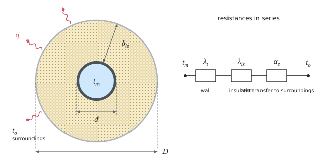

# Optimal insulation thickness of a pipe

The theory behind the calculation, in our own words. Kalketa checks the formulas in the frames.



## Why there is an optimum

A thicker insulation lets less heat through but costs more. The total cost per metre of pipe over the assessed period is the price of the insulation plus the price of the heat that escapes in that time:

```kalk
relation N == C_iz + q·C·τ
```

The price of the insulation grows roughly linearly with the thickness, the heat loss falls more and more slowly (the logarithm in the resistance of the insulation). The sum therefore has a minimum: that is the economically optimal thickness. It depends on the length of the assessed period. Over two years 50 mm pays off most, over a longer time a thicker insulation would come out.

The Czech standard for heat distribution (decree No. 193/2007 Coll.) prescribes the largest heat transfer coefficient. The SEI opinion, from which the example comes, shows that the economically better insulation tends to be thicker than the decree requires.

## Heat transfer through a cylindrical wall

Heat passes in turn through the pipe wall, the insulation and from the insulation surface into the air. The thermal resistances per metre of length are in series and add up:

- a cylindrical layer from diameter d₁ to d₂ with conductivity λ: ln(d₂/d₁)/(2·π·λ),
- transfer from a surface of diameter D with coefficient α: 1/(π·α·D).

The heat transfer coefficient per metre of length is the reciprocal of the sum:

```kalk
d := 48.3 mm
D := 148.3 mm
λ_iz := 0.038 W/(m·K)
α_e := 10 W/(m^2·K)
R_iz := ln(D/d)/(2·π·λ_iz) | m·K/W
R_e := 1/(π·α_e·D) | m·K/W
check "the insulation has the largest resistance": R_iz > 4·R_e
```

The resistance of the steel wall is negligible against the insulation (λ = 50 W/(m·K), thousandths of m·K/W), yet the source includes it. It neglects the resistance of the transfer from water to the wall.

For the 20 mm thickness the source gives the outer diameter of the insulation D = 0.0683 m. That is the diameter for a 10 mm thickness; its result U₀ = 0.3463 W/(m·K) however corresponds to the correct D = 48.3 + 2·20 = 88.3 mm.

## Water temperature and price of heat

The heating water has the highest temperature only at the outdoor design temperature. With equithermal control it falls roughly linearly with the outdoor temperature, so for the mean outdoor temperature of the heating season t_v the mean water temperature is:

```kalk
relation t_m == (t_w - t_i)·(t_v - t_e)/(t_i - t_e) + t_i
```

The price of heat grows faster than inflation (by z − i per year in real prices). The mean real price over n years is the mean of a geometric series:

```kalk
C_tp := 1.44 Kč/kWh
z := 8 %
i_f := 3 %
n := 2
C_ts := C_tp·((1 + z - i_f)^n - 1)/(n·(z - i_f)) | Kč/kWh
check "over two years the mean of the first and the second year": abs(C_ts - C_tp·(1 + (z - i_f)/2)) ≤ 0.0001 Kč/kWh
```
