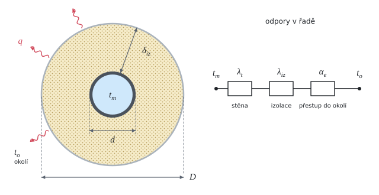

# Optimální tloušťka izolace potrubí

Teorie k výpočtu, vlastními slovy. Vzorce v rámečcích Kalketa ověřuje.



## Proč optimum

Silnější izolace propustí méně tepla, ale stojí víc. Celkové náklady na metr potrubí za posuzované období jsou cena izolace plus cena tepla, které za tu dobu uteče:

```kalk
relation N == C_iz + q·C·τ
```

Cena izolace roste s tloušťkou zhruba lineárně, ztráta tepla klesá čím dál pomaleji (logaritmus v odporu izolace). Součet má proto minimum: to je ekonomicky optimální tloušťka. Závisí na délce posuzovaného období. Za dva roky se nejvíc vyplatí 50 mm, za delší dobu by vyšla silnější izolace.

Norma pro rozvody tepla (vyhláška č. 193/2007 Sb.) předepisuje největší součinitel prostupu tepla. Stanovisko SEI, ze kterého příklad je, ukazuje, že ekonomicky výhodnější izolace bývá silnější, než kolik požadavek vyhlášky vyžaduje.

## Prostup tepla válcovou stěnou

Teplo prochází postupně stěnou potrubí, izolací a z povrchu izolace do vzduchu. Tepelné odpory na metr délky jsou v řadě a sčítají se:

- válcová vrstva z průměru d₁ na d₂ s vodivostí λ: ln(d₂/d₁)/(2·π·λ),
- přestup z povrchu o průměru D se součinitelem α: 1/(π·α·D).

Součinitel prostupu na metr délky je převrácená hodnota součtu:

```kalk
d := 48.3 mm
D := 148.3 mm
λ_iz := 0.038 W/(m·K)
α_e := 10 W/(m^2·K)
R_iz := ln(D/d)/(2·π·λ_iz) | m·K/W
R_e := 1/(π·α_e·D) | m·K/W
check "izolace má odpor nejvíc": R_iz > 4·R_e
```

Odpor ocelové stěny je proti izolaci zanedbatelný (λ = 50 W/(m·K), tisíciny m·K/W), zdroj ho přesto započítává. Odpor přestupu z vody do stěny zanedbává.

Zdroj u tloušťky 20 mm uvádí vnější průměr izolace D = 0,0683 m. To je průměr pro tloušťku 10 mm; jeho výsledek U₀ = 0,3463 W/(m·K) ale odpovídá správnému D = 48,3 + 2·20 = 88,3 mm.

## Teplota vody a cena tepla

Otopná voda má nejvyšší teplotu jen při venkovní výpočtové teplotě. Při ekvitermní regulaci klesá s venkovní teplotou zhruba lineárně, a tak se pro průměrnou venkovní teplotu topného období t_v spočte střední teplota vody:

```kalk
relation t_m == (t_w - t_i)·(t_v - t_e)/(t_i - t_e) + t_i
```

Cena tepla roste rychleji než inflace (o z − i ročně v reálných cenách). Střední reálná cena za n let je průměr geometrické řady:

```kalk
C_tp := 1.44 Kč/kWh
z := 8 %
i_f := 3 %
n := 2
C_ts := C_tp·((1 + z - i_f)^n - 1)/(n·(z - i_f)) | Kč/kWh
check "za dva roky průměr prvního a druhého roku": abs(C_ts - C_tp·(1 + (z - i_f)/2)) ≤ 0.0001 Kč/kWh
```
