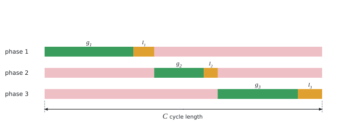

# Cycle length of a traffic signal

The theory behind the calculation, in our own words. Kalketa checks the formulas in the frames.



## Critical ratio of a phase

The saturation flow s is the largest flow that passes the stop line during green when the queue of vehicles discharges without interruption (of the order of 1,800 vehicles per hour per lane). In each phase the stream with the largest ratio of the actual flow q to the saturation flow decides. That is the critical ratio y = q/s, the share of the cycle that the phase needs for green.

## Webster’s formula

From simulations of vehicle delay Webster (1958) derived the cycle length for which the delay is smallest:

```kalk
relation C_o == (1.5·L + 5 s)/(1 - Y)
```

L is the lost time of the cycle (the sum of the intergreen times, when no vehicles move at the full rate), Y the sum of the critical ratios. A short cycle loses too much time on intergreens, a long one makes vehicles wait needlessly. The minimum is flat, so the cycle is rounded to 5 s. For Y → 1 the cycle grows without limit: the intersection is at the limit of its capacity.

## Split of the green

The effective green of the cycle C − L is divided in proportion to the critical ratios. All phases then have the same degree of saturation X = Y·C/(C − L):

```kalk
y_1 := 0.3
y_2 := 0.2
Y := y_1 + y_2
C := 60 s
L := 10 s
g_1 := y_1/Y·(C - L)
g_2 := y_2/Y·(C - L)
check "the same degree of saturation": abs(y_1·C/g_1 - y_2·C/g_2) ≤ 0.000001
```
